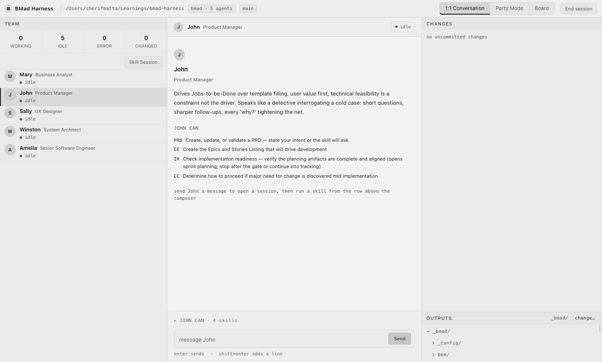
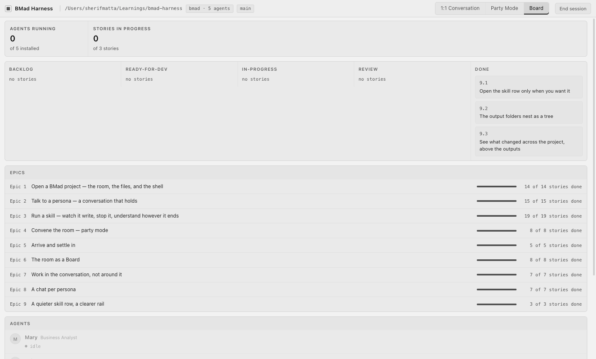

# BMad Harness

A desktop app for working with a [BMad](https://github.com/bmad-code-org/BMAD-METHOD)-installed project. Instead of a flat list of slash commands and walls of terminal text, the harness puts the BMad team in one window: each persona has its own chat, its skills sit one click away, and the project's files update in a live rail beside the conversation.

The guiding idea is **presence, not autonomy**. The harness does not make the agents do more. It makes what they are already doing visible: the PRD writing itself section by section, the persona who is writing it, and the file settling on disk when it is done.



## What it does

- **Opens any BMad project with no setup.** Personas, their skill menus and the project's place in the pipeline all come from what is installed on disk, through BMad's own resolvers. If a prerequisite is missing, launch tells you which one and how to fix it, rather than opening an empty room.
- **Gives each persona a chat.** Mary, John, Sally, Winston and Amelia (plus any other agent you install) each have a separate conversation. Selecting a persona starts nothing. Your first message starts their session, and that session keeps running in the background while you talk to someone else. You can switch with a tile, the keyboard, or `@name`.
- **Runs skills from inside the conversation.** The button row under the composer shows exactly the current persona's menu, for example *Create PRD* for John or *Build* for Amelia. There is no separate launcher or command palette.
- **Shows documents being written as they are written.** A running skill shows a live document card with the file path, the section being written now, the prose streaming in, and the sections still to come. You can stop it from the card. A stopped or failed run leaves the file byte-for-byte as written and tells you how far it got.
- **Keeps the filesystem as the only source of truth.** The *Outputs* rail is a live tree of the project's output folder, and *Changes* lists the uncommitted files. Click an output to open it read-only in its own window, which reloads when the file changes.
- **Party mode.** Choose a cast and open a room where every persona is visible, the current speaker is lit, and you can type at any moment. The room writes its summary into the project.
- **Board.** Shows sprint status as a board (backlog → ready → in progress → review → done) with progress for each epic and what every agent is working on, all read from `sprint-status.yaml`.



### What it deliberately doesn't do

The harness never writes into your project. Transcripts, layout and window state live under the app's own `userData` directory. It is not an editor, it never recommends a "next step", and it never reverts or patches a file a run was writing. It reports, and you decide. Persona words always come from that persona's own running `claude` session and are never written by the harness.

## Requirements

- **macOS**, which is the only packaged target.
- **Node.js 24.15+**
- **[Claude Code](https://claude.com/claude-code)** (`claude`) on your `PATH` and signed in, because each persona runs as a `claude` session.
- **[uv](https://docs.astral.sh/uv/)** with Python 3.11 or newer available, so it can run BMad's configuration resolvers.
- A project with BMad installed, meaning it has `_bmad/` and `.claude/skills/`. This repo is one, so you can point the harness at itself.

## Getting started

```bash
npm install

# Open the Welcome window and pick a project (recent projects are remembered)
npm run dev

# Or open a project directly
npm run dev -- /path/to/your/bmad-project
npm run dev -- .        # this repo, which is itself a BMad project
```

To build a standalone macOS app into `dist/`:

```bash
npm run package
```

## Development

| Command | What it does |
| --- | --- |
| `npm run dev` | Run the app with hot reload (electron-vite) |
| `npm run build` | Build main, preload and renderer into `out/` |
| `npm test` | Unit suite, then the filesystem-watcher suite on its own (macOS shares one file-event stream between watchers, so they run serially) |
| `npm run lint` | ESLint, including the layering rule, plus a check that dependency pins match `DEPENDENCIES.md` |
| `npm run typecheck` | Type-check the main and renderer projects |

Husky runs the checks on commit. Dependencies are pinned exactly as a set that installs together, and [`DEPENDENCIES.md`](DEPENDENCIES.md) explains the three versions that are deliberately held back.

### How the code is organised

It is an Electron + React + TypeScript app built with electron-vite. The main process owns all durable state, and the renderer is unprivileged. Code is split into layers, and **a layer may only import from the layers below it**. ESLint enforces this as an error (see `eslint.config.mjs`).

```
src/
  renderer/ui/          View         React components (chat, board, party, outputs, ...)
  renderer/design/      Design       the token file and base styles, the one visual contract
  shared/               Bridge       the event/command contract that crosses the preload bridge
  main/projections/     Projections  state built from folded events: personas, runs, rail, board
  main/fold/            Fold         pure functions over recorded sequences (frames, sprint status, ...)
  main/sources/         Sources      the outside world: claude sessions, file watchers, install, preflight
  main/windows/         Windows      the project, document and Welcome windows, app menu, notifications
```

Two kinds of truth reach the UI and are never merged. The **event stream** from a persona's `claude` session drives the live document card and persona state. The **filesystem** drives the outputs rail, changes and board.

`fixtures/runs/` holds raw `claude` stream-json recordings of real skill runs, including interrupts, failures and multi-file writes. The tests replay them through the real bridge. `scripts/record-run.mjs` records new ones.

### Planning artifacts

This project was itself planned and built with BMad, and everything is under `_bmad/`:

- `_bmad/specs/spec-bmad-visual-harness/SPEC.md`: the product contract (capabilities, constraints, non-goals)
- `_bmad/planning-artifacts/architecture/`: the architecture spine (AD-1 … AD-31)
- `_bmad/planning-artifacts/ux-designs/`: `DESIGN.md`, `EXPERIENCE.md` and mockups
- `_bmad/planning-artifacts/epics.md` and `_bmad/implementation-artifacts/`: epics, story specs and retrospectives
