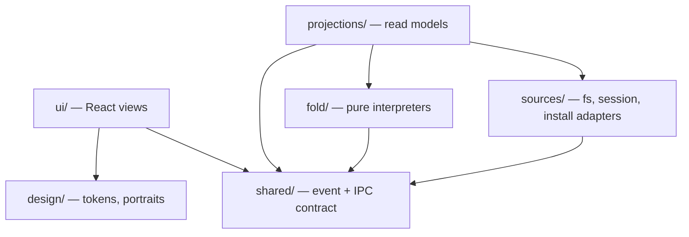
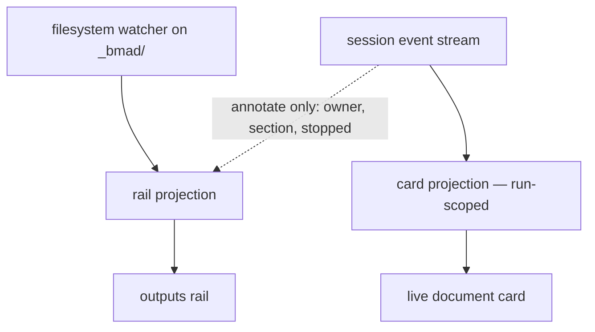

# Architecture Spine — bmad-visual-harness

## Design Paradigm

**Read-only projection: an event-sourced read model with no write side.**

The harness owns no state of its own. It observes three external sources of truth — the
project filesystem, the BMad install, and a persona session's event stream — folds each into a
read model, and renders it. There is no command side: nothing the harness does changes the
project except by handing work to the installed runtime, which writes on its own account.

That single framing carries most of this spine for free. "No write side" is why the rail can
never disagree with disk, why concurrent writers need no arbitration, why a stopped run needs
no rollback, and why harness state can never masquerade as project state.

One product test overrides every architectural virtue here: **if it reads as a chat box with a
portrait glued on, it has failed regardless of feature completeness.** Restraint in the shell
and real faces in the room (the Team tiles, the cast, the Welcome; the chat itself carries
initials, AD-16) are what buy the perceived intelligence back, which is why AD-14, AD-16 and
AD-20 are invariants rather than styling preferences.

Layers, in dependency order — each may depend only on what sits below it:

| Layer | Directory | Owns |
| --- | --- | --- |
| View | `src/renderer/ui/` | React components; renders projections, holds nothing durable |
| Design | `src/renderer/design/` | Tokens; pure portrait functions |
| Bridge | `src/shared/` | Domain event and IPC types only — no behaviour |
| Projections | `src/main/projections/` | Main-held read models: rail, sessions, install, personas |
| Fold | `src/main/fold/` | Pure interpreters — no I/O, no clock, no filesystem |
| Sources | `src/main/sources/` | Adapters: filesystem watcher, persona session, install resolver, skill manifest |



Nothing in `ui/` may reach `sources/`, `fold/` or `projections/`. Nothing in `fold/` may reach
`sources/`. No arrow points upward.

## Invariants & Rules

### AD-1 — The harness writes nothing into the project

- **Binds:** all
- **Prevents:** harness bookkeeping appearing in the outputs rail as if it were a project artifact, and any path where the harness and a run both claim authorship of a file.
- **Rule:** Every byte under the project's `_bmad/` tree got there because the runtime wrote it. Transcripts, session logs, caches and window state live in Electron `userData`, keyed by project path. No harness code path writes inside the project root.

### AD-2 — The two truth channels never merge

- **Binds:** CAP-5, CAP-6, CAP-11, CAP-12
- **Prevents:** the outputs rail asserting a file that never landed, and the live card silently becoming a cache of project state.
- **Rule:** A rail row exists, and claims content, only because the filesystem watcher saw the file. The session stream may *annotate* a row with run-scoped metadata — owning persona, section in flight, stopped — but may never create a row, remove one, or assert what a file contains. A row reaches `saved` because the watcher saw the write land, never because the stream announced it. A rail row carries **two independent fields that are never written by both sources**: a disk-derived `state` (`absent` → `changing` → `saved`), owned solely by the watcher, and an optional run-derived `annotation` (owner, section in flight, `stopped`), owned solely by the stream. There is no precedence question because there is no shared field. In-flight state for a writer the harness is **not** running (an editor, a terminal `claude`) therefore still works: `changing` comes from watcher activity plus a settle debounce, so CAP-6's "by any writer" holds without the stream. The live document card is run-scoped: born with a skill invocation, dies with it.



### AD-3 — One contract crosses the bridge: events out, commands in

- **Binds:** CAP-2, CAP-4, CAP-5, CAP-6, CAP-9, CAP-11, CAP-12
- **Prevents:** two interpreters disagreeing about the current section; a Claude Code wire-format change rippling into components; and — the sharper risk — two consumers of one event assuming different payload shapes or different cardinality.
- **Rule:** Main folds raw `stream-json` into domain events; the renderer sends commands and never parses a raw frame.
  - **Events out:** `session:opened`, `session:awaiting-turn`, `session:closed`, `persona:said`, `persona:state`, `run:started`, `run:note`, `run:step` (AD-22), `doc:section-opened`, `doc:prose`, `doc:committed`, `run:finished`, `run:stopped`, `run:failed`, `rail:changed`, `board:changed` (Story 6.2: once per revision of the parsed `sprint-status.yaml`, read once in main, answered on connecting by `board.get`). (`harness:said` is also declared in `src/shared/events.ts`; it is a harness line, not a persona's.)
  - **Commands in:** `session.open(agentId)`, `session.close(sessionId)`, `turn.send(sessionId, text, mention?)` (AD-25), `menu.dispatch(sessionId, code)`, `run.stop(runId)`, `turn.stop(sessionId)` (AD-23), `doc.open(path)`, `conversation.end(projectId)`. *(Epic 7, 2026-10-14: no command is added or redeclared by AD-26 to AD-28 except, possibly, the one that starts a skill-first session, left to Story 7.5's spec; see below.)*
  - Every event and command is declared once in `src/shared/` with an explicit payload type **and a stated cardinality**. Adding a field is additive; changing or removing one is a version bump on the contract, which is stamped on every persisted log (AD-4). A renderer-only event is a smell.
  - **Menu entries resolve in main, never in the renderer.** The renderer sends a `code`; main resolves it against the currently resolved configuration and decides `skill` versus `prompt`. A renderer holding a resolved skill name goes stale the instant the install is re-resolved (AD-8). The one skill name that does reach the renderer is a recorded fact about a run already started, never something it dispatches by (AD-24).
  - **Identity:** `sessionId` is the primary key for everything session-scoped; `runId` for everything run-scoped. `agentId` says which agent a session activated and **may be absent**, but its absence never says what the session is: a session's **kind** does (persona, room or skill-first, AD-26). A persona tile aggregates the sessions carrying its `agentId`.
  - **Epic 7's additions to the contract are additive only, and `CONTRACT_VERSION` is unchanged** (2026-10-14): `BoardStory.file` and `BoardEpic.file` (AD-28), the install snapshot's `skills` (AD-27), and what lets a window see a skill-first session and tell its records apart (an optional `skill` beside `agentId` on `session:opened` and `session:closed`, its listing in `conversation.get`, and a session flag on its records, AD-26). `session.close` and `conversation.end` keep their declarations. **Not decided here:** the command form that starts a skill-first session (a third argument form of `session.open` beside an `agentId` and `{ room }`, or a new command); whichever it is, the renderer sends only the text the user typed and main resolves the skill (AD-24), and it is additive.
  - **Routing rules**, so the same bytes are never rendered twice or lost: main-thread `text_delta` outside a tool call is `persona:said`; prose inside a document write comes from `input_json_delta` on that call and is `doc:prose`; writes to `.memlog.md` are `run:note` and **never** `doc:prose`, so memlog text can never enter the document buffer or its section parser, and they raise no `run:step` either; every other main-thread tool call of a run is a `run:step` (AD-22), a document `Write` or `Edit` included, which also raises its `doc:*` events under the same call id; anything with `parent_tool_use_id` is subagent activity (AD-6) and raises neither.

### AD-4 — Interpreters are pure folds over a recorded sequence

- **Binds:** CAP-5, CAP-11, CAP-12
- **Prevents:** the highest-churn module in the system being testable only by waiting out a multi-minute skill run.
- **Rule:** Every session writes its raw `stream-json` to a log under `userData`. Every interpreter in `fold/` is a pure function of the event sequence — no I/O, no filesystem, no wall clock except as an injected value. Recorded sessions are committed to `fixtures/runs/` as the replay corpus, covering at minimum: a Fast-path single large write, a Coaching-path batched write, a `SIGINT` mid-write, and a failure inside the reviewer gate. Each log is stamped with the contract version it was produced under (AD-3). The raw log is the **forensic and replay** record only — it is never the authority for what the UI shows on restart; that is the materialised projection (AD-7). Logs are retained per project with a bounded cap and pruned oldest-first.

### AD-5 — A write counts on `tool_result`, never `tool_use` [ADOPTED]

- **Binds:** CAP-5, CAP-6, CAP-12
- **Prevents:** reporting a section as written when the write was announced but never landed — and the inverse error of assuming one confirmation maps to one section.
- **Rule:** The unit of confirmation is the *tool call*, not the section. BMad does not author section by section on disk: a Fast-path run commits a whole document in one `Write` and then lands ~20 revision `Edit`s; a Coaching-path run commits several sections per write. On `tool_result`, every section parsed from that call's accumulated input becomes committed together; on `tool_result` with `is_error: true`, none of them did and that call names what failed to land. `Write` and `Edit` are both stream sources, and their handling differs: a `Write` replaces the document buffer and may open new sections; an `Edit` patches it and is a **revision** — it re-parses sections but never advances the section counter, which matters because 20 of 21 observed writes in a Fast-path run were revision `Edit`s. **Cardinality is fixed: exactly one `doc:committed` per tool call**, carrying that call's id and the list of sections it committed. It is never fanned out per section — a 15-section single write emits one event naming fifteen sections, and the call id is what AD-5's error rule needs to say which call failed. Settled by `execution-model.md`.

### AD-6 — Subagent output is never the persona's voice [ADOPTED]

- **Binds:** CAP-3, CAP-5, CAP-9
- **Prevents:** research and reviewer-gate chatter rendering as the persona speaking, which destroys the specific-colleague illusion CAP-3 exists to create.
- **Rule:** Anything carrying `parent_tool_use_id` belongs to a subagent. Only main-thread `text_delta` may render as a persona turn. Subagent activity renders on the card from `system/task_progress` (description, tokens, `last_tool_name`, duration) **where the runtime emits it** — it is not guaranteed on every run, which is why `.memlog.md` is the card's dependable dead-air feed rather than a fallback. The CLI also gates subagent text behind `--forward-subagent-text`, which this spine does not pass, so AD-6 holds by default as well as by rule. Settled by `execution-model.md`.

### AD-7 — Main owns all durable state; the renderer owns none

- **Binds:** CAP-2, CAP-8
- **Prevents:** a session dying with a window reload, and cross-restart continuity becoming a retrofit after the transcript shape is already set.
- **Rule:** The conversation transcript, session state and install model live in main; the transcript is persisted per project under `userData`, while session state and the install model are not (sessions are not held across restarts, and the install model is re-derived from disk — AD-1, AD-18). The renderer is a pure projection: a reload loses nothing — **including a run in flight**, because the card is a main-held projection like every other and is re-emitted on reconnect, not reconstructed from renderer memory. Within one persona session, context is genuinely continuous (AD-18). **Across** personas it is not: context is never transplanted, and continuity between personas is carried by the project artifacts the previous persona wrote. A persona with no live session is opened on first use; one with a live session is resumed, not restarted (AD-18, amended 2026-10-14), and the thread stays the project's one conversation either way. CAP-8's "no handoff presents as a restart" holds; its "prior context intact" holds in substance only insofar as BMad's memlog-then-derive puts that context on disk.

### AD-8 — Effective BMad configuration comes only from BMad's own resolvers

- **Binds:** CAP-1, CAP-3, CAP-4, CAP-9
- **Prevents:** showing a user the wrong skill buttons because their `_bmad/custom/` overrides were never applied — the exact rot the spec's read-don't-model constraint exists to stop.
- **Rule:** `customize.toml` is never read directly. Effective configuration is obtained by invoking `_bmad/scripts/resolve_config.py`, `_bmad/scripts/resolve_customization.py` and the party skill's own `scripts/resolve_party.py` — they do **not** all live in one directory — and consuming the merged JSON. The harness implements no TOML layering of its own. Every resolver invocation is bounded by a timeout and has a defined failure path: a failed resolve degrades to the last good result and surfaces a named error, and never silently yields an empty roster. Configuration files are watched and re-resolved on change; **re-resolution updates the roster and the menus and never touches a live session**, so an agent that vanishes from the install keeps its session and its stop control until the user closes it.

### AD-9 — A menu entry carries exactly one of `skill` or `prompt`

- **Binds:** CAP-4
- **Prevents:** silently dead buttons — six of the ten Business Analyst entries are `prompt`-style, so a `skill`-only dispatcher leaves 60% of that menu inert.
- **Rule:** An entry carries `code` (the key), `description` (the button label) and exactly one of `skill` or `prompt`. Both dispatch as a turn into the live persona session (AD-18): `skill` as `/<skill-name>`, `prompt` as its text verbatim. An entry with neither is a discovery error surfaced to the user, never a silent no-op.

### AD-10 — Agents are enumerated from `_bmad/config.toml`

- **Binds:** CAP-1, CAP-3, CAP-10
- **Prevents:** discovering agents by globbing skill directories on a name prefix — a hardcode of BMad's layout, which CAP-1 forbids.
- **Rule:** The `[agents.*]` tables in the resolved config are the authoritative roster and supply `name`, `title`, `icon`, `description`, `module`, `team` — feeding the persona tile, chat header and party cast. Per-agent resolved customization supplies the menu. `identity` and `communication_style` are not harness-injected: the persona session activates the agent's own skill, which loads them itself (AD-18). That is what makes the persona talk like the persona.

### AD-11 — One turn in flight per session; sessions run concurrently

- **Binds:** CAP-4, CAP-5, CAP-11
- **Prevents:** two skill invocations racing inside one session, a card with two streams and no defined behaviour, and a chat turn typed mid-run being mistaken for the run's own completion.
- **Rule:** **Turns within a session are strictly serialised by the harness.** At most one turn — chat or run — is in flight per session; anything the user types during a run queued and sent when that turn completes. A session can also take turns nobody sent (background subagents finishing wake the main thread), so a `result` row ends *a* turn and not necessarily the one the harness sent (`fixtures/runs/README.md`, "A session takes turns nobody sent"). Whether a turn the harness sent is over is decided by the harness's own turn bookkeeping, not by counting `result` rows: the session is free only when a main-thread `result` arrives with the CLI's live background-task set (`system/background_tasks_changed`) empty, a `result` with tasks live leaves it busy, and a main-thread message that starts while it is free is a turn nobody sent and makes it busy again (`src/main/fold/turn-end.ts`). A **run** is a turn dispatched from a menu entry (AD-9), bounded by `run:started` and a terminal run event; a plain chat turn is not a run and raises no card. Skill buttons are disabled whenever any turn is in flight; the composer is not. Any turn in flight, chat or run, can be stopped (AD-23). Different sessions run concurrently. Concurrent personas *can* still collide on one artifact — `bmad-correct-course` touches the PRD, epics, architecture and UX at once, so BMad's artifact ownership is mostly but not wholly disjoint. That collision is not prevented here; it is governed by AD-12, and the rail reports the contention rather than resolving it. Cards are conversation entries in time order: the active persona's card renders full (prose body and the not-yet-written sections by name), a non-active persona's collapses to one live line carrying real state (persona · section · elapsed · stop) and expands on persona switch or click. A collapsed card is never a spinner.

### AD-12 — The harness reports; it never arbitrates

- **Binds:** CAP-6, CAP-7, CAP-12
- **Prevents:** a locking, merging or conflict-resolution scheme being invented for writes the harness does not make.
- **Rule:** When an external writer changes a file, the filesystem arbitrates and last writer wins. The harness reflects the new state and, where a run was writing that file, reports the contention. It never locks, reverts, patches or restores. A stopped or failed run's partial file is already byte-for-byte the last successful write, so there is nothing to revert.

### AD-13 — The renderer is unprivileged, and project content is untrusted

- **Binds:** CAP-2, CAP-7
- **Prevents:** a document window rendering markdown from a project file straight into the DOM, and a renderer that can reach the filesystem or spawn a process directly.
- **Rule:** The trust boundary is explicit and asymmetric: the project's **code** — its skills, its `_bmad/scripts/` resolvers, the runtime it configures — is trusted, because the user already executes exactly that code every time they run BMad in this project, and the harness runs it with no more privilege than they do. The project's **content** — the markdown of a PRD, an architecture doc, a party summary — is untrusted the moment it is rendered, because it is largely model-authored. `contextIsolation` on, `nodeIntegration` off, `sandbox` on. Every privileged capability crosses one narrow, explicitly enumerated preload API — no generic `invoke(channel, …)` passthrough. Markdown from project files is rendered through `markdown-it` with HTML disabled and sanitized with DOMPurify before insertion. Document windows reload from the watcher, not from a renderer-initiated read. **Amended 2026-10-14 (Epic 7):** the chat reuses this boundary and adds no other. A completed persona turn is rendered through the same `renderMarkdown` and the one `MarkdownBody` `innerHTML` the document window uses, and nothing else in the product sets inner HTML; a turn still streaming is plain text and is rendered once when it ends, a render that comes back empty for a non-empty turn is drawn as plain text, and the user's turn, syslines, decision blocks, a run card's prose and step labels stay plain text. A Board card opens a document only by passing main's own path to `doc.open` (AD-28), which resolves inside the output folder as it always has.

### AD-14 — One token file is the visual contract; nothing hardcodes a value

- **Binds:** CAP-2, CAP-3, CAP-9, CAP-10
- **Prevents:** independently built surfaces — persona tiles, party cast, document card, rail — converging on "roughly the same dark grey", which is how a deliberately restrained UI stops reading as deliberate.
- **Rule:** `design/tokens.css` opens with the mockup's `:root` block copied unchanged: the four-step surface ramp `--bg:#101317` → `--chrome:#14181d` → `--panel:#171b21` → `--panel-2:#1b2027` → `--panel-3:#20262e`, the hairlines `--line`/`--line-soft`, the text ramp `--text`/`--text-strong`/`--dim`/`--faint`, the single accent `--accent:#7fa6e8` with `--accent-bg`, the state triple `--green:#6aa87f`/`--amber:#c6a350`/`--red:#c47c72`, and `--mono`/`--sans`; these are the **dark** theme, and the light theme is the same names with their own values (`DESIGN.md`, Story 5.2). The mockup expresses several load-bearing values as literals rather than variables; those are **named in the same file** and are equally binding: the layout constants, the radius family (`3px` chips and tags, `4px` skill buttons, `5px` base `--r`, `6px` cards, `8px` document window — one radius is *not* the rule), the type scale (base `13px`/`1.55`, `--mono` for file paths and metadata, `--sans` for prose), and a `note`-state blue, which the mockup inlines as the accent hex and which needs its own token so blue-as-accent and blue-as-state are distinguishable. **`tokens.css` owns every value and `DESIGN.md` → binding constants owns their current numbers**; this spine does not restate them, because the mockup's rail `348px`, party panel `288px` and topbar `42px` were superseded (rail `300px`, Team sidebar `244px`, header `46px`, party panel `240px`) and a restated number drifts. A literal colour, dimension, radius or font stack in a component is a defect.

### AD-15 — Stream deltas never pass through component state one at a time

- **Binds:** CAP-5
- **Prevents:** the app janking during the single moment the whole product is judged — a document writing itself in front of the user.
- **Rule:** Main coalesces deltas before emitting. The card commits accumulated text to one node on an animation frame. No React state update is driven by an individual `input_json_delta`. Sizing that makes this non-negotiable: one observed document write decomposed into 5,795 deltas carrying 69,031 characters.

### AD-16 — Portraits are pure, deterministic, asset-free, and illustrated colleagues

- **Binds:** CAP-3, CAP-10
- **Prevents:** the same agent wearing different faces across sessions or machines; any licensing or asset-pipeline dependency; and — the project's single highest risk — an art direction that reads as childish and takes the perceived intelligence down with it.
- **Rule:** The art-direction target is a **company-directory illustrated headshot: a plausible colleague. Not pixel art, not a JRPG sprite, not a cartoon.** Procedural inline SVG, parameterized per persona (skin and shade, hair colour with style and fringe, optional beard, glasses, earrings, shirt and collar, background), legible at every size it is drawn. `portrait(artParams, size, state) -> SVG string` and `artParamsFor(agentId) -> artParams` are pure functions with no I/O and no external assets; `state` is accepted from the start so the deferred reactive-face tier item needs no signature change. The five core personas carry curated params; every other installed agent derives params from its agent id. Determinism is asserted in tests. The `icon` field is never rendered as a portrait. **Where a portrait appears (amended 2026-10-09):** only on the Team tiles, the cast cards, the cast chooser and the Welcome, at the closed set `36 | 44` (`PortraitSize`); **no portrait is drawn below 36px**, which is the legibility floor. The chat thread, the chat header and every small agent reference carry an **initials disc** instead (26px, 22px, 20px): `initialsOf(name)` is a pure function of the roster's display name with no I/O and no external asset, the persona disc is neutral for every persona (no per-persona colour, so nothing here can make two surfaces disagree), and only the user's own disc is tinted. **Amended 2026-10-14 (Epic 7):** a skill-first session's turn carries the same neutral disc with `initialsOf` the skill's name, and its speaker label is the skill's name in mono; it never carries a persona's initials or face (AD-26). A persona is still keyed by `agentId` (AD-3); the initials are presentation of `name`, never a key.

### AD-17 — Launch preflight names what is missing

- **Binds:** CAP-1
- **Prevents:** the harness opening to an empty room with no personas and no explanation, which reads as broken rather than as unconfigured.
- **Rule:** At launch the harness verifies `claude` is on `PATH` and authenticated, that `uv` with Python 3.11+ is available, **and that the target project actually resolves at least one agent** — a user-scoped rather than project-scoped BMad install resolves none under AD-18's `--setting-sources project,local`, which is exactly the empty room this AD exists to prevent. Any failure is reported naming the specific missing prerequisite and its remedy. CAP-1 promises zero *configuration*, not zero *prerequisites*.

### AD-18 — The persona session is the unit of interaction

- **Binds:** CAP-2, CAP-3, CAP-4, CAP-5, CAP-8, CAP-11, CAP-12
- **Prevents:** a product where you cannot simply talk to a persona; a persona whose voice is assembled by the harness rather than lived by the agent; and a failed run with no one left to explain it, which would force the harness to speak in a persona's name — the fake personhood the spec names as a trust liability.
- **Rule:** Talking to a persona opens a long-lived session: `claude -p --input-format stream-json --output-format stream-json --include-partial-messages --verbose --setting-sources project,local`, with `/bmad-agent-<x>` sent as the **first turn on stdin** — not as a positional prompt, since `--input-format` is only valid alongside `--print` and the prompt then arrives on the stream. Party mode is a session of the same process kind, opened with `/bmad-party-mode`; it carries a `sessionId` but no `agentId`, which is what AD-19 means by a room-owned identity. **Amended 2026-10-14 (Epic 7):** a session has one of three **kinds**, persona, room or skill-first (AD-26), and an absent `agentId` no longer means the room. Main already holds one live persona session per `agentId` and answers a second `session.open` for a live persona with the same session, so turning to a persona who is live resumes it and spawns nothing, with no cap on how many are live; the user ends a seat with `session.close`, which writes **one harness line** saying that persona's session ended and leaves every record in the thread, so the thread does not read as if the persona still remembers it, and the next message opens a new session with no earlier context. A relaunch ends every process and no seat is resumed (the CLI is started with no resume flag; a spike for one is open). **Chat turns and skill invocations are both turns into a session** — there is no second run kind. Three flags are load-bearing and may not be dropped: `--include-partial-messages` is what makes `input_json_delta` exist at all (without it CAP-5 has no prose to stream), `--setting-sources project,local` restricts resolution to the project and local sources and so **excludes the `user` source** — the subprocess sees the target project's `.claude/skills/` and none of whoever-is-running-the-harness's user-level Claude configuration, which is CAP-1's mechanism for a session that depends only on what is in the project, and `--input-format stream-json` is what keeps the session alive. Sessions are reclaimed when the persona is closed or the session ended (AD-21); they are not held across app restarts. A `result` row arrives **per turn**, not once per process, and ends *a* turn — not necessarily the one the harness sent, since a session also takes turns nobody sent (AD-11): `is_error: true` marks stopped or failed (`subtype` says which kind: `error_during_execution`, `error_max_budget_usd`, any other error subtype), its absence marks finished; do not test `stop_reason`, which is not stable across them (`null` on the spike's interrupted turns, `tool_use` in the corpus recordings, absent on a budget failure). Process exit code is **not** the signal — a session outlives every turn in it. **Stop (settled, Story 1.1; extended to any turn by AD-23):** `run.stop` and `turn.stop` write one in-band `control_request` with `subtype: "interrupt"` to the session's stdin; the CLI answers `control_response` `success` and ends the turn with a `result` row within milliseconds (3-6ms, n=4), the process stays alive and the next turn is accepted. `SIGINT` exits the subprocess `rc=0` in under 400ms (217-390ms, n=4) and ends the session, so it is reserved for ending a session and never used to stop a run. If the interrupt is not acknowledged, falling back to `SIGINT` costs the session, and that cost is surfaced to the user, never hidden. The control protocol is not documented in `claude --help`; a future CLI release could change it (`_bmad/spikes/spike-stop-semantics.md`, caveat 2).

### AD-19 — Pipeline position and file ownership are derived, never asked

- **Binds:** CAP-1, CAP-6, CAP-9
- **Prevents:** a setup step asking the user what stage they are at — the precise thing CAP-1's zero-configuration promise rules out — and a rail that cannot name an owner for a file it did not watch being written.
- **Rule:** Pipeline position is read from the artifacts present under `_bmad/` and from the sprint status file; the harness never asks and never stores its own answer. A rail row's owner is a **`sessionId`**, resolved for display to that session's `agentId` where it has one. It comes from the session that wrote the file when the harness observed that write, and otherwise from the artifact class, since BMad personas own *mostly* disjoint artifacts. A party transcript row is owned by the room — a session of kind room (AD-26), which has no `agentId` — which is why owner is a session identity and not an agent (AD-3). A row whose owner cannot be derived shows none rather than guessing.

### AD-20 — Every indicator is driven by real system state

- **Binds:** CAP-3, CAP-5, CAP-6, CAP-12
- **Prevents:** decorative motion and states that look alive without being alive — the failure the spec rules out with "animation must carry information, never decoration."
- **Rule:** Persona state is a projection, not a UI flag, with exactly one source each: `idle` = no session or nothing running; `work` = any turn is in flight, chat or run, and it persists through quiet subagent phases because the work is still running; `live` = a long-running attached process the session started (a test watcher) — **distinct from a skill invocation, and it does not disable the persona's skill buttons**; `note` = the watcher saw a change to a file this persona owns per AD-19; `error` = this persona's last run failed or was stopped. No state exists for decoration, no element animates unless the thing it depicts is actually happening, and `@media (prefers-reduced-motion: reduce)` disables all animation and transition globally. A run's tool steps follow the same rule (AD-22): a step reads running only between its call being issued and its result, and none is drawn for a call that has not happened. A stopped plain chat turn is not an error (AD-23). The `error` indicator is an alert only — the substance of a failure belongs in the conversation in the persona's own voice, which AD-18 keeps alive to deliver.

### AD-21 — The negative surface: no guidance, no launcher, no editor

- **Binds:** CAP-4, CAP-7, all
- **Prevents:** the three things a builder will reasonably want to add and which the spec explicitly rejected rather than deferred.
- **Rule:** No highlighting, badging, sorting or recommending of a next move anywhere — the skill buttons plus the output list are enough and the user decides. No separate skills list, launcher or command palette exists anywhere in the product; skills are reachable only as the current persona's buttons, **with one exception (amended 2026-10-14, Epic 7):** the list `/` opens as the first character of the composer (FR131), which puts text in the composer and sends nothing, shows every skill of the manifest unranked and unhidden (AD-27), and appears nowhere else. The entry to an empty chat (a *Skill Session* option under the personas, the owner's suggestion) opens a chat and lists no skill. Document windows are read-only previews; the harness never becomes an editor. An explicit end-session control exists and is the only way to clear a persisted conversation — it is not a next-step suggestion; ending one seat (`session.close`) clears no transcript.

### AD-22 — A run's tool steps are one main-folded event, keyed by the call

- **Binds:** CAP-5, CAP-11, CAP-12
- **Prevents:** a step list with no real source (AD-20); two surfaces deriving different labels for one call; raw tool input — a command line, a search query, a path outside the project — reaching the renderer; and a step marked running after its run has ended.
- **Rule:** Main folds every main-thread tool call of a run into `run:step`, declared in `src/shared/events.ts` as a union on `status`: `{ runId, sessionId, callId, status: 'running', label, at }`, then `{ runId, sessionId, callId, status: 'done' | 'failed', at }`. **Cardinality:** exactly one `running` per call, raised when its input has finished streaming (`content_block_stop`: the call is whole and the tool is executing), then exactly one `done` or `failed` on its `tool_result`, `failed` being the CLI's own `is_error` (AD-5's source). A call that never gets a result is closed on the card by the run's terminal event as `failed` at that event's `at`, with no event of its own, so no step is left running after its run (AD-20). Time is injected (`ctx.now`, AD-4), and a step's duration is the second `at` minus the first; calls issued together share one result frame, so their durations are approximate. A plain chat turn has no `runId` and raises none. A call aimed at `.memlog.md` raises none (its text is `run:note`, AD-3); a document `Write` or `Edit` raises one beside its `doc:*` events, and the shared `callId` joins them. Subagent frames are dropped in `readFrame` before any state is consulted (AD-6), so a subagent's own calls neither open nor close a step; the main-thread call that spawns the subagent is one step.
  - **The label is derived in main and is the only thing about a call's input that crosses.** A pure fold module holds a closed table of tool name → verb and **one** allow-listed input field: `file_path` as the project-relative path (a path outside the project reduces to its basename), `Skill` as its skill name, a subagent spawn as its subagent type, a fetch as its host only, `Bash` as the program name only and never an argument or the raw command; search tools and anything unlisted carry the verb or the tool's own name alone. The fold keeps a bounded buffer of that one decoded field and forwards nothing else. Control characters are stripped and the label is capped at about 48 characters, paths truncated from the left. The harness does not make a label friendlier than verb plus target (`read design/tokens.css`, not `read story 5.6`), because a friendlier one needs words it would have to invent.
  - **Where it lives.** Steps are part of the run's card: `RunCardSnapshot.steps` holds `{ callId, label, status, startedAt, endedAt?, notesBefore }`, where `notesBefore` is how many notes the card held when the step began. Steps and notes interleave **by fold order, never by timestamp** — a note's `at` is when the watcher saw the append, which lags the write. The card is already a main-held projection re-emitted on reconnect and kept beside the transcript (AD-7), so a window reload and an app restart need no new store: a stored card with no `steps` loads as none and `TRANSCRIPT_VERSION` and `CONTRACT_VERSION` do not change; a run cut off by an app exit is read back with its running steps `failed` at its last event (`deadOf`). The renderer folds the same events into the same card, and `tests/run-card-parity.test.ts` holds the two equal. A card holds at most 300 steps, dropping the oldest finished ones and never a running one.

### AD-23 — Any turn in flight is stopped by one command

- **Binds:** CAP-11, CAP-12
- **Prevents:** a header `Stop` that has nothing to stop with outside a run; two stop paths that end the same run differently (`run:stopped` from one and `run:failed` from the other); and a stopped chat turn reading as a failure.
- **Rule:** `turn.stop(sessionId)` is declared in `src/shared/commands.ts` beside `run.stop(runId)`, which stays for the run card (CAP-11). Both reach one path in `session-stop.ts`, keyed by the session entry: the in-band `control_request` interrupt of AD-18, with the same acknowledgement window and the same surfaced fallback cost. **A run in flight is the turn, so it ends `run:stopped` whichever control was pressed.** For a plain chat turn the entry's `interrupting` mark, set before the interrupt is written (today only a room's send sets it), is what turns the turn's failed `result` into a stop: no failure line, and the persona returns to its resting state rather than `error` (AD-20). Main writes **one harness line** for a stopped plain chat turn (`harness:said`, kept with the transcript so it reads the same after a reload; wording is Voice and Tone's); the persona's words so far stay as they were. A turn with nothing in flight answers `not-found`, which the renderer treats as `run.stop`'s is: the control it was pressed on is already gone. Queued composer messages are not touched by a stop. The chat header's slot reads `Stop` while a turn is in flight and `close session` otherwise (settled with the UX owner, 2026-10-09); the room keeps its own rule, where a send interrupts the speaker.

### AD-24 — A skill name reaches the renderer once, as a recorded fact

- **Binds:** CAP-3, CAP-4, CAP-8
- **Prevents:** a card head that names a skill the renderer had to resolve itself, and — the AD-3 risk — a renderer holding a name that goes stale when the install is re-resolved.
- **Rule:** `run:started` carries an optional `skill`, set by main only when the dispatched menu entry resolved to a skill (AD-9), never for a `prompt` entry, and kept on the run's card so a stored run reads as it did live. It is a record of what was invoked and **never an input to dispatch**: the renderer still sends only `code`, and nothing re-resolves the field, so re-resolution (AD-8) cannot make it wrong. A run started as the carry-on of a stopped one takes the stopped run's `skill` with its `code` and plan. With no `skill` the card head reads `run` alone. **The handoff sysline gains no skill**: a tile click or an `@name` never names one, so `handed to <persona> · <skill>` has no v1 producer, and the line stays `handed to <Name>` until one exists (an event that says a persona was handed a *skill* is the revisit condition). **Amended 2026-10-14 (Epic 7):** the line is no longer written at all for a tile click or an `@name`, because a persona whose seat is live is turned to and not handed to (AD-18). And `skill` is also set for a skill-first session's first turn (AD-26): main resolves the typed `/<name>` against the install's skill list (AD-27) and records it, still a record and never an input.

### AD-25 — A user's turn records what they typed beside what was sent

- **Binds:** CAP-2, CAP-8
- **Prevents:** a typed `@amelia` vanishing from the turn that carried it, and — the sharper risk — a display text that can differ from what the persona received, which would let the harness show words nobody sent (AD-18).
- **Rule:** `turn.send` takes an optional third argument, `mention`: the literal `@name` token the user typed to hand off, and nothing else. The turn's `text` stays what the persona receives (the words after the name), and `UserRecord` gains an optional `mention`, so a user turn is always displayed as the mention and then the sent text and **cannot show anything that was not typed or sent**. Main drops a `mention`, without refusing the turn, unless it is `@` and one token that names the persona whose session receives it (compared case-insensitively against the roster's `name`), so the chip is honest and a room never takes one. The live window's entry, a queued message (`QueuedMessage`, `UserEntry`) and the main-process record all carry it, so a queued handoff, a reload and a restart read as they did live. It is additive: a stored file without it loads as plain text and the version is unchanged. A handoff with no text after the name sends no turn and, from 2026-10-14 (AD-18), shows nothing: the window turns to that persona's seat.

### AD-26 — A session has a kind, and a missing `agentId` is not one

- **Binds:** CAP-2, CAP-3, CAP-8, CAP-9
- **Prevents:** a skill-first session being taken for the room, because today an entry with no `agentId` means the room in six places (`src/main/session-bridge.ts`: a send records `room`, a close says the room's line, a menu dispatch is refused, `conversation.get` leaves it out of `sessions` and looks for a `roomCast`, a busy send interrupts it; `src/main/session-registry.ts`: `say` flags `room`); a skill's lines landing in the room's or a persona's thread; and a run with no `agentId` being read as a party session, which Recent activity does today (`src/renderer/ui/board/board-activity.ts`).
- **Rule:** A session entry is one of three kinds, **persona** (`agentId`), **room** (a cast) or **skill-first** (a `skill`), held in the registry by `sessionId`, and every place that treated an absent `agentId` as the room reads the kind instead. A skill-first session is started by a typed `/<name>` whose `<name>` is in the install's skill list (AD-27): main resolves the name, writes the message as typed as the first turn (the spawn already takes a first turn for a session with no agent), and records the name as the run's `skill` (AD-24). A message whose name is not installed starts nothing and is answered by one harness line. A typed `bmad-agent-*` skill opens that persona's seat and `bmad-party-mode` opens the room, with nothing else about either changed; every other skill, `bmad-build-auto` included, starts a skill-first session. Its records carry a flag naming the session, by the room's precedent, and are drawn only in that session's own thread: **the project's shared thread (AD-7) is unchanged and draws none of them, and neither does the room's.** Live skill-first sessions have no cap and end only by `session.close`, which kills the process and removes that session's own records; a relaunch ends the process (FR100), so its row is listed with its thread and no live dot, and a message to it says so and starts nothing. A run in one is a run card in its own thread, named in Recent activity by its skill with Story 6.7's dot, time and state rules, never in a Board column, with no story owner derived (FR123) and no count in the Agents panel, which counts personas. **Not decided here:** the `code` Recent activity prints after `started` for such a run, and the command that starts the session (AD-3); both are Story 7.5's spec.

### AD-27 — The install's skill list is read once from its manifest, in main

- **Binds:** CAP-1, CAP-4
- **Prevents:** a renderer that lists, filters or hard-codes skills and goes stale when the install changes (AD-3, AD-8); a list built by globbing skill directories on a name prefix (AD-10), which breaks when a skill is renamed; and a second, unwatched reader of a file the install already declares.
- **Rule:** The list is `_bmad/_config/skill-manifest.csv`, read in main by a reader in `sources/install/` and parsed by a pure fold in `fold/`, and carried to the renderer as an additive `skills` field of the install snapshot, so it is watched and re-read with the install and re-reading never touches a live session (AD-8). The format, read from the file (29 rows in this install): header `canonicalId,name,description,module,path`; every field quoted, RFC 4180, with commas and doubled quotes inside descriptions, so it is parsed and never split on `,`. Order is the manifest's. A row with no `name` is skipped; a missing or unreadable file gives an empty list and no error shown. The manifest is the install's own declaration of what it provides and is **not effective configuration**, so AD-8's resolvers-only rule does not apply to it; the roster still comes only from `[agents.*]` (AD-10), and a `bmad-agent-*` skill is a row in the list like any other. No code under `src/` read this file before Story 7.3.

### AD-28 — The Board's file for a story or an epic is resolved in main

- **Binds:** CAP-6, CAP-7
- **Prevents:** a renderer that builds a path from a sprint key, which is not the file's name (key `5-2-…the-system-s-theme` has file `spec-5-2-…the-systems-theme.md`; Story 2.14's file is `spec-chat-look-flat-rows-and-initials.md`; an unbuilt story has none); and a Board card that becomes a control it cannot stand behind.
- **Rule:** Beside `sprint-status.yaml`, main lists `implementation-artifacts/` under the output folder, read-only, and a story's file is the one entry whose name begins `spec-<epic>-<story>-`, with zero or several matches meaning no file; an epic's file is `epic-<n>-context.md` (a retrospective is dated, and its sprint key names a status row, not a file). `BoardStory` and `BoardEpic` gain an optional project-relative `file`, recomputed when the Board is read and when the rail's watcher sees a change under that folder. The renderer passes main's path to `doc.open` unchanged and never builds, joins or guesses one; `doc.open` still resolves it lexically and by real path inside the output folder (AD-13) and opens `refused` or `missing` as it does from the rail. A card or row with a file is a native button and one without is plain text; nothing else on the Board becomes a control, and the Board still writes nothing (AD-1).

## Consistency Conventions

| Concern | Convention |
| --- | --- |
| Naming — domain events | `noun:verb-past` (`run:started`, `doc:committed`). Declared once in `src/shared/`; a renderer-only event is a smell. |
| Naming — personas | Addressed by BMad `agentId` (`bmad-agent-pm`) everywhere internally, including party turn attribution. Display `name`/`title`/`icon` are presentation only and never used as keys. |
| Naming — files | `kebab-case.ts`; one exported concept per module in `fold/` so it can be replayed in isolation. |
| Data — paths | Project-relative POSIX paths in all domain events; absolute paths exist only inside `sources/` and `windows/`. |
| Data — time | Epoch milliseconds in events; formatting is the renderer's business. Elapsed run time derives from `run:started`, and a step's from its own `running` and `done`/`failed` instants (AD-22), never from a per-tick field. |
| Data — errors | Every failure crossing the bridge is `{ code, message, detail? }` with a stable `code`. Raw subprocess stderr never reaches the renderer. |
| State — mutation | Projections are updated only by applying a domain event. No projection is mutated from a UI action; a UI action sends a command to main, which acts and emits. |
| State — watcher | Configured for atomic temp-file rename (how `memlog.py` writes) and for coalescing — rapid appends land inside ~400ms and do not arrive one event per entry. Misconfigure it and appends are missed or double-counted. Document commits are whole-file writes, so an on-disk delta is a full replacement and all incremental diffing must come from the stream. |
| State — progress | Section names and the predicted denominator come from the skill's own template under its `assets/` directory, then from the run's `.memlog.md` concern-scan entry, which lands early enough to be usable. Observed headings win and the denominator grows; a section the user has already seen is never renumbered. The card's foot lists not-yet-written sections **by name**, from that same source. |
| State — dead air | The risk window is the parallel-subagent phases (discovery research, the reviewer gate), not the document render. There the card's secondary feed is `.memlog.md`, appended entry by entry with each decision and its reason, interleaved with the run's tool steps (AD-22), and the persona state stays `work`. |
| Cross-cutting — logging | Structured lines to `userData`, never to the project. A session's raw stream log is the forensic record (AD-4). |
| Cross-cutting — platform | Every macOS-specific call (`open -R`, `open -a`) is confined to `src/main/windows/`; no OS branch elsewhere. |
| Cross-cutting — persona voice | The harness never authors words attributed to a persona. Every persona utterance is main-thread `text_delta` from that persona's session. Disagreement in party mode is the skill's to generate and is grounded in project artifacts; the harness never stages, ranks or amplifies it. |

## Stack

Verified against the npm registry on 2026-09-23, **as a set that installs together** — three rows are deliberately not the newest published version, and each carries the reason. Do not bump these individually.

| Name | Version | Why this pin |
| --- | --- | --- |
| Electron | 44.4.5 | current stable |
| Node.js (bundled by Electron 44) | 24.18.1 | — |
| Chromium (bundled by Electron 44) | 152 | — |
| React | 19.3.0 | current stable |
| TypeScript | 6.0.3 | **not 7.0.2.** `typescript-eslint` peers `typescript <6.1.0`, so TS 7 has no linter at all, and TS 7 ships no public programmatic compiler API before 7.1. Revisit when both land. |
| Vite | 7.3.6 | **not 8.3.0.** `electron-vite@5` peers `vite ^5 \|\| ^6 \|\| ^7`; Vite 8 is supported only by `electron-vite@6.0.0-beta`. |
| electron-vite | 5.0.0 | current stable |
| @vitejs/plugin-react-swc | 4.3.3 | **not `@vitejs/plugin-react`**, whose 6.x peers `vite ^8.0.0` only — no Vite version satisfies both it and electron-vite 5. |
| electron-builder | 26.15.3 | current stable |
| Vitest | 5.0.1 | peers Vite ^7; transpile-only, so unaffected by the TS pin |
| typescript-eslint | 8.70.1 | the constraint behind the TypeScript pin |
| chokidar | 4.0.3 | **not 5.0.0**, which is ESM-only; electron-vite's default CJS main output with externalised deps would emit `require('chokidar')` and hit `ERR_REQUIRE_ESM`. Revisit only alongside an ESM main build. |
| markdown-it | 15.0.2 | current stable |
| DOMPurify | 3.4.16 | current stable |
| Claude Code CLI (`claude`) | the user's own install, not bundled | — |
| uv + Python (BMad resolvers) | 3.11+, the user's own install | — |

## Structural Seed

### Processes and external truth

```mermaid
graph LR
  subgraph HARNESS["Harness"]
    MAIN["Electron main — privileged"]
    REND["Renderer — conversation, rail, party"]
    DOC["Document windows — read-only preview"]
  end
  CLI["live sessions — claude, one per seat: a persona's, the room's, or a skill-first session (AD-26)"]
  FS["project _bmad/ tree"]
  INST["BMad install — config.toml, resolvers, skill manifest"]
  UD["userData — transcripts, session logs"]

  MAIN -->|spawn, chat and skill turns, stop interrupt on stdin| CLI
  CLI -->|stream-json on stdout| MAIN
  CLI -->|writes| FS
  FS -->|watch| MAIN
  INST -->|resolver subprocess; manifest read (AD-27)| MAIN
  MAIN -->|domain events over preload IPC| REND
  MAIN -->|file content on watcher change| DOC
  MAIN --> UD
```

`REND` and `DOC` have no edge to `FS`, `CLI` or `INST`. That absence is AD-13.

### Source tree

```text
bmad-harness/
  src/
    main/
      sources/       # fs watcher · persona session · install resolver
      fold/          # pure interpreters — no I/O, no clock
      projections/   # rail · sessions · personas · install read models
      windows/       # app window, document windows, macOS shell escapes
    preload/         # the one narrow bridge surface
    shared/          # domain event + IPC types only
    renderer/
      ui/            # shell (1:1 / party switch, help) · conversation · rail · party · doc window
      design/        # tokens.css · portrait functions
  fixtures/runs/     # recorded stream-json — the replay corpus
```

### Deployment and environments

One environment: a developer's own macOS machine. The harness runs from source
(`electron-vite` dev) or as a local unsigned `electron-builder` package. No code signing, no
notarization, no auto-update channel, no installer matrix, no server-side component and no
network service of the harness's own — its only outbound work is the persona session, which
authenticates on the user's existing Claude Code login. One project per window.

## Capability → Architecture Map

| Capability | Lives in | Governed by |
| --- | --- | --- |
| CAP-1 zero-config discovery | `sources/install`, preflight | AD-8, AD-10, AD-17, AD-18, AD-19, AD-27 |
| CAP-2 conversation + state in one window | `sources/session`, `projections/sessions`, `renderer/ui` | AD-7, AD-13, AD-14, AD-18, AD-25, AD-26 |
| CAP-3 personas have faces and identities | `sources/session`, `renderer/design`, `projections/personas` | AD-6, AD-10, AD-14, AD-16, AD-18, AD-20, AD-24 |
| CAP-4 persona-scoped skill buttons | `projections/install`, `sources/session` | AD-8, AD-9, AD-11, AD-18, AD-21, AD-24, AD-27 |
| CAP-5 documents write visibly | `fold/document`, `renderer/ui/card` | AD-2, AD-3, AD-4, AD-5, AD-6, AD-15, AD-22 |
| CAP-6 rail is a live view of disk | `sources/fs`, `projections/rail` | AD-1, AD-2, AD-5, AD-12, AD-19 |
| CAP-7 documents open in own window | `main/windows`, `renderer/ui/doc` | AD-12, AD-13, AD-21, AD-28 |
| CAP-8 persona handoff mid-session | `projections/sessions` | AD-7, AD-11, AD-18, AD-24, AD-25, AD-26 |
| CAP-9 party mode | `sources/session`, `renderer/ui/party` | AD-3, AD-6, AD-8, AD-14, AD-16, AD-19 |
| CAP-10 real portraits for every agent (on the tiles, cast and Welcome; the chat carries initials) | `renderer/design` | AD-10, AD-16 |
| CAP-11 a run can be stopped | `sources/session`, `fold/run` | AD-2, AD-4, AD-5, AD-11, AD-18, AD-22, AD-23 |
| CAP-12 failed and stopped runs are legible | `fold/run`, `projections/rail`, `sources/session` | AD-2, AD-4, AD-5, AD-12, AD-18, AD-20, AD-22, AD-23 |

## Deferred

- **The Agent SDK as the runtime.** Rejected on authentication, not ergonomics: Anthropic's terms require third-party products built on the Agent SDK to use API-key auth rather than the user's claude.ai login, and spawning the `claude` binary the user already authenticated does not. **Revisit only if** the harness ever ships carrying its own key — at which point `interrupt()`, `canUseTool` and typed hooks replace the hand-written control messages, signals and flags.
- **Party mode's disagreement and decision tracking.** `bmad-party-mode` emits prose and is explicitly instructed never to produce summaries or takeaways, so the *Open disagreements* and *Decisions so far* panels — and the transcript's `disagrees` / `evidence` tags and quoted-turn references — have no data source. The *Room* panel is **not** deferred: topic, who opened it, context documents in scope and the destination path are all harness-known. Note that `bmad-party-mode` **already ships and works** — group conversation, user participation and joint decisions function today, so CAP-9 is a surfacing problem, not orchestration to build. Party v1 ships the room: chosen cast, permanently visible faces, lit speaker, no turn-taking gate, the *Room* panel, and the summary written to `_bmad/`. **Revisit when** a structured source exists, most plausibly a `_bmad/custom/` override making the skill emit machine-readable markers.
- **Party mode's *Pause room*.** Pause is a lifecycle state distinct from stop, and neither CAP-11 nor AD-18 models it. **Revisit with** the disagreement panel, since both wait on party mode's second pass.
- **A thread per persona, and resuming a seat across a relaunch.** Both considered for Epic 7 and not built (2026-10-14). A per-seat thread was rejected: the thread stays the project's one conversation (AD-7, CAP-2). Resuming a seat means starting the CLI with its session id, which changes `SESSION_ARGS` (AD-18), a pinned, load-bearing set; **revisit with** a spike on whether the CLI resumes a stream-json session faithfully.
- **Signing, notarization, auto-update and distribution.** Not needed for a personal macOS build. **Revisit when** someone other than the author is meant to install it.
- **Windows and Linux support.** **Revisit if** a non-macOS user appears; AD-20's platform convention keeps the port additive rather than structural.
- **Light theme — no longer deferred.** Built as Theme (Story 5.2): the same token names with light values (AD-14).
- **Multi-project windows and cross-project state.** One project per window is a spec assumption; nothing here depends on it staying true.
- **Long scrollback virtualization.** **Revisit when** a persisted transcript is long enough to measure; AD-7 keeps it a renderer-local change.
- **Scope-tier Should/Could items** (`scope-tiers.md`): help section, reactive persona faces, tile hover previews, second opinion, refusal-with-handoff, idle barks. None changes a boundary decided here — AD-16 already accepts `state` so the reactive face needs no signature change, and the shell reserves a help entry point.

- **Newer BMad releases than 6.12.0.** The harness is built and verified against the installed BMad 6.12.0 and stays on it. The published docs (docs.bmad-method.org, read 2026-10-01 through a summarising fetch, so second-hand) describe a later layout; none of it overturns an AD, but four assumptions in this spine are coupled to 6.12.0 and should be checked on a real newer install before the harness is pointed at one. **Revisit when** the pinned BMad version is bumped or a user's project is on a newer one — start with a spike that installs the latest into a scratch project and runs the preflight and resolvers against it.
  - **Artifact layout (AD-1, AD-2, AD-19, CAP-6).** The watch root is `_bmad/`. The newer default output root is `_bmad-output/`, in `<type>-<slug>/` folders inside initiative folders, with files named `prd-<slug>.md`, `spec-<slug>.md`, `architecture-<slug>.md` (this project has `SPEC.md` and `ARCHITECTURE-SPINE.md`). `sprint-status.yaml` is replaced by `tickets.toml`, epic envelopes, story files and `plan-<slug>.md`; `src/main/fold/artifact-owner.ts` maps `sprint-status.yaml` to `bmad-agent-pm`. The watch root should come from the resolved `output_folder`, and artifact classification should tolerate both naming schemes. Unchecked: whether `src/main/sources/project/` already derives the root or hardcodes it.
  - **Pipeline position (CAP-1, AD-19).** The docs describe a loop (Clarify, Plan, Build and verify, Learn) with right-sizing, not a waterfall; PRD and architecture are optional and a small change skips both. Position is derived from artifacts, so the mechanism holds, but "correct pipeline state" needs a definition for a project that legitimately has no PRD. The SPEC wording "brief → PRD → epics and stories → build → review → launch" and CAP-8's "epics and sprint planning" describe 6.12.0 and drift on upgrade.
  - **Resolver paths and install (AD-8, AD-17).** AD-8 names `_bmad/scripts/resolve_config.py` and `resolve_customization.py`. The docs say `bmad setup` installs the "shared runtime and module scripts" but not that those filenames survive. The install route is now `npx skills add` or a plugin marketplace; a marketplace install is probably user-scoped and so resolves no agents under `--setting-sources project,local` — the empty room AD-17 already checks for. Its remedy text should point at the project-scoped install.
  - **Menus (AD-9, AD-10).** Menu codes change (Winston `CA, TK`, `IR` gone; John `PRD, CC, TK`). Resolved menus absorb this with no harness change; `bmad-ticket` replaces epics-and-stories and sprint planning as the planning skill.
  - **Unattended runs.** `bmad-build-auto` and its loop orchestrator are the autonomy this product cut as a non-goal, so they stay out. If that is ever revisited, the plan file's `status` and `blocked_reason` fields are the machine-readable source CAP-12 lacks today.

## Open Items

- **CAP-2's continuous cross-persona session vs. AD-18's per-persona sessions.** A session spans personas in the transcript and in the artifacts, but not in process. Confirm this satisfies the demonstrable form of the success signal before the build commits.
- **Turn queueing versus responsiveness.** AD-11 serialises turns, so a message typed during a twelve-minute run waits for it. Confirm in use that queued-and-visible reads as honest rather than as the composer being broken.
- **Step-list bounds and the stopped-turn line (UX owner).** A card keeps at most 300 steps (AD-22); how a card that dropped its earliest steps reads, and the wording of the harness line for a stopped chat turn (AD-23), are `EXPERIENCE.md`'s. So is whether a step label may be friendlier than verb plus target.
- **The entry to an empty chat (UX owner).** Where the user opens a chat with no persona. The owner suggested a *Skill Session* option under the personas; its place, wording and look are a later `bmad-ux` run, and Story 7.5 cannot be built before it.
- **A skill-first run's code and the command that starts one.** The `code` Recent activity prints after `started` for it, and whether starting a skill-first session is a third form of `session.open` or a new command (AD-3), are Story 7.5's spec.
- **No cap on live seats.** Each is a `claude` process, and AD-11 lets sessions run concurrently, so how many a machine bears, and whether the count shows beyond the live dots, is unmeasured. Revisit when measured.
- **Step durations for calls issued together are approximate** (AD-22): they share one result frame. Confirm in use that a row of equal elapsed times reads as honest.

## Spec Amendments Required

Decisions here that override the source contract. `SPEC.md` and its companions should be updated so upstream and this spine do not diverge.

| Source | What changed |
| --- | --- |
| `execution-model.md` | The runtime unit is a persona session, not one subprocess per skill (AD-18). The invocation and stop mechanics change with it. |
| `bmad-install-contract.md` | A menu entry carries exactly one of `skill` or `prompt`, not always `skill` (AD-9). The authoritative agent roster is `_bmad/config.toml` `[agents.*]`, not `customize.toml` (AD-10). |
| `SPEC.md` constraint "persona→skill mapping is read from each agent's `customize.toml`" | Now read from BMad's resolved configuration, because raw `customize.toml` omits `_bmad/custom/` overrides (AD-8). The constraint's intent is preserved; its letter is not. |
| `SPEC.md` assumption "zero configuration" | Zero configuration, but not zero prerequisites: `claude` authenticated, plus `uv` and Python 3.11+ (AD-17). |
| `SPEC.md` CAP-9 success | Not met as written in v1 — the disagreement and decision structure is deferred for want of a data source. |
| `SPEC.md` constraint "talk to one agent, get a result, move to the next" | Personas may run concurrently (AD-11), a deliberate user decision. The waterfall of the *method* is unchanged; the serialism of the *interaction* is not. |
| `SPEC.md` CAP-5 success "no spinner at any point" | A non-active persona's card collapses to a live one-line state (AD-11) rather than showing prose and the not-yet-written list. |
| `SPEC.md` CAP-3 ("portrait in the chat header") and CAP-10 ("portraits at every size the UI uses"); `ui-surfaces.md` → *Portraits* (32 transcript, 38 chat header, the party transcript's `portrait + name + role + timestamp`) | No longer hold in the chat thread or its header, which carry initials discs; they hold on the Team tiles, cast cards, cast chooser and Welcome, at `36 \| 44`, floor 36px (AD-16, from the UX decision of 2026-10-09; Story 1.13's 32px floor is replaced). |
| `SPEC.md` / `ui-surfaces.md` rule that there is no skills list, launcher or palette (FR30) | One exception: the list `/` opens in the composer (AD-21, AD-27), which sends nothing and lists every installed skill. The skill buttons stay the only other way to a skill. |
| `SPEC.md` open questions 1 and 2 | Both closed here: session history persists per project under `userData` (AD-7); concurrent writers need no arbitration (AD-12). |
