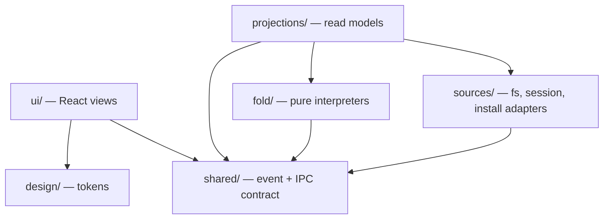
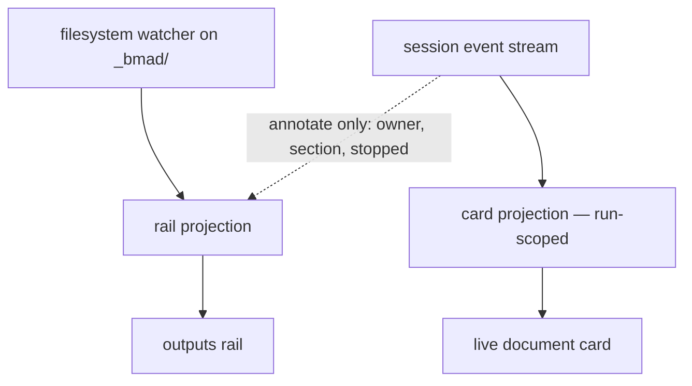

# Architecture Spine — bmad-visual-harness

## Design Paradigm

**Read-only projection: an event-sourced read model with no write side.**

The harness owns no state of its own. It observes three external sources of truth — the
project filesystem, the BMad install, and a persona session's event stream — folds each into a
read model, and renders it. There is no command side: nothing the harness does changes the
project except by handing work to the installed runtime, which writes on its own account.

That single framing carries most of this spine for free. "No write side" is why the rail can
never disagree with disk, why concurrent writers need no arbitration, why a stopped run needs
no rollback, and why harness state can never masquerade as project state.

One product test overrides every architectural virtue here: **if it reads as a chat box with a
portrait glued on, it has failed regardless of feature completeness.** Restraint in the shell
is what buys the perceived intelligence back, which is why AD-14, AD-16 and AD-20 are
invariants rather than styling preferences. *Amended 2026-10-15 (UX, Story 7.5):* the faces
that used to sit beside that restraint (the Team tiles, the cast, the Welcome) are gone, so
every seat in the product is an initials disc (AD-16) and no replacement identity device was
added; the test still stands, and what it polices is now the shell's restraint alone.

Layers, in dependency order — each may depend only on what sits below it:

| Layer | Directory | Owns |
| --- | --- | --- |
| View | `src/renderer/ui/` | React components; renders projections, holds nothing durable |
| Design | `src/renderer/design/` | Tokens (and, until the portrait-removal story lands, the portrait functions AD-16 retires) |
| Bridge | `src/shared/` | Domain event and IPC types only — no behaviour |
| Projections | `src/main/projections/` | Main-held read models: rail, sessions, install, personas |
| Fold | `src/main/fold/` | Pure interpreters — no I/O, no clock, no filesystem |
| Sources | `src/main/sources/` | Adapters: filesystem watcher, persona session, install resolver, skill manifest |



Nothing in `ui/` may reach `sources/`, `fold/` or `projections/`. Nothing in `fold/` may reach
`sources/`. No arrow points upward.

## Invariants & Rules

### AD-1 — The harness writes nothing into the project

- **Binds:** all
- **Prevents:** harness bookkeeping appearing in the outputs rail as if it were a project artifact, and any path where the harness and a run both claim authorship of a file.
- **Rule:** Every byte under the project's `_bmad/` tree got there because the runtime wrote it. Transcripts, session logs, caches and window state live in Electron `userData`, keyed by project path. No harness code path writes inside the project root. **Amended 2026-10-20 (Epic 9, Story 9.3; AD-31):** that includes `.git/`. A plain `git status` may rewrite `.git/index` and the untracked cache, so the one git command the harness runs carries `--no-optional-locks` and fetches nothing (AD-31). **One accepted exception:** a clean or process filter the repository configures in `.gitattributes` (Git LFS is the common one) can run during that status and write where it writes, such as `.git/lfs/`. It is the project's own code, which the user already runs on every `git status` and which AD-13 trusts; the harness adds no write of its own.

### AD-2 — The two truth channels never merge

- **Binds:** CAP-5, CAP-6, CAP-11, CAP-12
- **Prevents:** the outputs rail asserting a file that never landed, and the live card silently becoming a cache of project state.
- **Rule:** A rail row exists, and claims content, only because the filesystem watcher saw the file. The session stream may *annotate* a row with run-scoped metadata — owning persona, section in flight, stopped — but may never create a row, remove one, or assert what a file contains. A row reaches `saved` because the watcher saw the write land, never because the stream announced it. A rail row carries **two independent fields that are never written by both sources**: a disk-derived `state` (`absent` → `changing` → `saved`), owned solely by the watcher, and an optional run-derived `annotation` (owner, section in flight, `stopped`), owned solely by the stream. There is no precedence question because there is no shared field. In-flight state for a writer the harness is **not** running (an editor, a terminal `claude`) therefore still works: `changing` comes from watcher activity plus a settle debounce, so CAP-6's "by any writer" holds without the stream. The live document card is run-scoped: born with a skill invocation, dies with it. **Amended 2026-10-20 (Epic 9, Story 9.3; AD-31):** git's list of uncommitted files is a **third channel**, read only by AD-31's source and drawn only in the rail's Changes half. A Changes row is never merged with a rail row, never annotated by the session stream, and never creates, removes or changes a rail row; a file uncommitted under the output folder is two rows, one in each half, each with its own facts.



### AD-3 — One contract crosses the bridge: events out, commands in

- **Binds:** CAP-2, CAP-4, CAP-5, CAP-6, CAP-9, CAP-11, CAP-12
- **Prevents:** two interpreters disagreeing about the current section; a Claude Code wire-format change rippling into components; and — the sharper risk — two consumers of one event assuming different payload shapes or different cardinality.
- **Rule:** Main folds raw `stream-json` into domain events; the renderer sends commands and never parses a raw frame.
  - **Events out:** `session:opened`, `session:awaiting-turn`, `session:closed`, `persona:said`, `persona:state`, `run:started`, `run:note`, `run:step` (AD-22), `doc:section-opened`, `doc:prose`, `doc:committed`, `run:finished`, `run:stopped`, `run:failed`, `rail:changed`, `board:changed` (Story 6.2: once per revision of the parsed `sprint-status.yaml`, read once in main, answered on connecting by `board.get`). (`harness:said` is also declared in `src/shared/events.ts`; it is a harness line, not a persona's.)
  - **Commands in:** `session.open(agentId)`, `session.close(sessionId)`, `turn.send(sessionId, text, mention?)` (AD-25), `menu.dispatch(sessionId, code)`, `run.stop(runId)`, `turn.stop(sessionId)` (AD-23), `doc.open(path)`, `conversation.end(projectId)`. *(Epic 7, 2026-10-14: no command is added or redeclared by AD-26 to AD-28 except, possibly, the one that starts a skill-first session, left to Story 7.5's spec; see below.)*
  - Every event and command is declared once in `src/shared/` with an explicit payload type **and a stated cardinality**. Adding a field is additive; changing or removing one is a version bump on the contract, which is stamped on every persisted log (AD-4). A renderer-only event is a smell.
  - **Menu entries resolve in main, never in the renderer.** The renderer sends a `code`; main resolves it against the currently resolved configuration and decides `skill` versus `prompt`. A renderer holding a resolved skill name goes stale the instant the install is re-resolved (AD-8). The one skill name that does reach the renderer is a recorded fact about a run already started, never something it dispatches by (AD-24).
  - **Identity:** `sessionId` is the primary key for everything session-scoped; `runId` for everything run-scoped. `agentId` says which agent a session activated and **may be absent**, but its absence never says what the session is: a session's **kind** does (persona, room or skill-first, AD-26). A persona tile aggregates the sessions carrying its `agentId`.
  - **Epic 7's additions to the contract are additive only, and `CONTRACT_VERSION` is unchanged** (2026-10-14): `BoardStory.file` and `BoardEpic.file` (AD-28), the install snapshot's `skills` (AD-27), and what lets a window see a skill-first session and tell its records apart (an optional `skill` beside `agentId` on `session:opened` and `session:closed`, its listing in `conversation.get`, and a session flag on its records, AD-26). `session.close` and `conversation.end` keep their declarations. **Not decided here:** the command form that starts a skill-first session (a third argument form of `session.open` beside an `agentId` and `{ room }`, or a new command); whichever it is, the renderer sends only the text the user typed and main resolves the skill (AD-24), and it is additive. **Amended 2026-10-15 (UX, Story 7.5), constraints on that command:** it carries the whole first message, since the process is spawned on it; main reads the first word, so the renderer never splits or tests it; and its reply is one of *a skill-first session opened* (its `sessionId`), *a persona's seat or the room to turn to*, or *refused with the word*. A refusal is the **reply** to the command and not an event: the New session chat has no session to scope a `harness:said` to (AD-29), and a reply is not a renderer-only event.
  - **Epic 8's addition is additive only, and `CONTRACT_VERSION` is unchanged** (2026-10-17): an optional `agentId` on the conversation snapshot's user and harness-line entries (`UserRecord`, `SyslineRecord`) and on the `harness:said` event, an optional `activation` flag on `PersonaRecord`, and an `{ agentId }` form of `session.close`'s target (AD-30). No command or event is added, removed or re-typed, and `session.open` keeps its declaration. *(Amended 2026-10-20, Story 8.7, built: "`session.open` keeps its declaration" held for the command, its name and its one argument, and not for that argument's target. Story 8.3 added two forms to `SessionTarget`, `{ seat: AgentId; message: string; mention?: string }` and `{ seat: AgentId; code: string }`, beside an `agentId`, `{ room }` and `{ first }`; the first is a first message to a persona with no seat, the second a skill button pressed on an empty chat. Story 8.1 added the optional `attributed?: true` to `TranscriptFile`, set by every write of this build, which marks a file that has been through the one-time attribution of AD-30. All of it is additive and optional; `TranscriptFile` stays version 1, `CONTRACT_VERSION` stays 1, and the 8 commands, 17 events and 36 channels are unchanged. Pinned by `tests/contract.test.ts`, with the one shared membership predicate pinned by `tests/negative-surface.test.ts`.)*
  - **Epic 9 adds no domain event and no command, and `CONTRACT_VERSION` is unchanged** (2026-10-20, Story 9.3; AD-31). The Changes half is fed by two **bridge channels** declared in `src/shared/channels.ts`, after the pattern of `install:get` / `install:changed` and not in `events.ts`: `changes:get`, which answers the snapshot main holds, and `changes:changed`, pushed once per revision of that snapshot and never when a read returns what is already held. The rail split's share adds one validated layout request channel (Story 9.3). The 8 commands and 17 events stand; the pinned channel count in `tests/contract.test.ts` moves from 36 by exactly the channels Story 9.3 adds, each tied to its preload literal.
  - **Routing rules**, so the same bytes are never rendered twice or lost: main-thread `text_delta` outside a tool call is `persona:said`; prose inside a document write comes from `input_json_delta` on that call and is `doc:prose`; writes to `.memlog.md` are `run:note` and **never** `doc:prose`, so memlog text can never enter the document buffer or its section parser, and they raise no `run:step` either; every other main-thread tool call of a run is a `run:step` (AD-22), a document `Write` or `Edit` included, which also raises its `doc:*` events under the same call id; anything with `parent_tool_use_id` is subagent activity (AD-6) and raises neither.

### AD-4 — Interpreters are pure folds over a recorded sequence

- **Binds:** CAP-5, CAP-11, CAP-12
- **Prevents:** the highest-churn module in the system being testable only by waiting out a multi-minute skill run.
- **Rule:** Every session writes its raw `stream-json` to a log under `userData`. Every interpreter in `fold/` is a pure function of the event sequence — no I/O, no filesystem, no wall clock except as an injected value. Recorded sessions are committed to `fixtures/runs/` as the replay corpus, covering at minimum: a Fast-path single large write, a Coaching-path batched write, a `SIGINT` mid-write, and a failure inside the reviewer gate. Each log is stamped with the contract version it was produced under (AD-3). The raw log is the **forensic and replay** record only — it is never the authority for what the UI shows on restart; that is the materialised projection (AD-7). Logs are retained per project with a bounded cap and pruned oldest-first.

### AD-5 — A write counts on `tool_result`, never `tool_use` [ADOPTED]

- **Binds:** CAP-5, CAP-6, CAP-12
- **Prevents:** reporting a section as written when the write was announced but never landed — and the inverse error of assuming one confirmation maps to one section.
- **Rule:** The unit of confirmation is the *tool call*, not the section. BMad does not author section by section on disk: a Fast-path run commits a whole document in one `Write` and then lands ~20 revision `Edit`s; a Coaching-path run commits several sections per write. On `tool_result`, every section parsed from that call's accumulated input becomes committed together; on `tool_result` with `is_error: true`, none of them did and that call names what failed to land. `Write` and `Edit` are both stream sources, and their handling differs: a `Write` replaces the document buffer and may open new sections; an `Edit` patches it and is a **revision** — it re-parses sections but never advances the section counter, which matters because 20 of 21 observed writes in a Fast-path run were revision `Edit`s. **Cardinality is fixed: exactly one `doc:committed` per tool call**, carrying that call's id and the list of sections it committed. It is never fanned out per section — a 15-section single write emits one event naming fifteen sections, and the call id is what AD-5's error rule needs to say which call failed. Settled by `execution-model.md`.

### AD-6 — Subagent output is never the persona's voice [ADOPTED]

- **Binds:** CAP-3, CAP-5, CAP-9
- **Prevents:** research and reviewer-gate chatter rendering as the persona speaking, which destroys the specific-colleague illusion CAP-3 exists to create.
- **Rule:** Anything carrying `parent_tool_use_id` belongs to a subagent. Only main-thread `text_delta` may render as a persona turn. Subagent activity renders on the card from `system/task_progress` (description, tokens, `last_tool_name`, duration) **where the runtime emits it** — it is not guaranteed on every run, which is why `.memlog.md` is the card's dependable dead-air feed rather than a fallback. The CLI also gates subagent text behind `--forward-subagent-text`, which this spine does not pass, so AD-6 holds by default as well as by rule. Settled by `execution-model.md`.

### AD-7 — Main owns all durable state; the renderer owns none

- **Binds:** CAP-2, CAP-8
- **Prevents:** a session dying with a window reload, and cross-restart continuity becoming a retrofit after the transcript shape is already set.
- **Rule:** The conversation transcript, session state and install model live in main; the transcript is persisted per project under `userData`, while session state and the install model are not (sessions are not held across restarts, and the install model is re-derived from disk — AD-1, AD-18). The renderer is a pure projection: a reload loses nothing — **including a run in flight**, because the card is a main-held projection like every other and is re-emitted on reconnect, not reconstructed from renderer memory. Within one persona session, context is genuinely continuous (AD-18). **Across** personas it is not: context is never transplanted, and continuity between personas is carried by the project artifacts the previous persona wrote. A persona with no live session is opened on its first message and not on selection; one with a live session is resumed, not restarted (AD-18, AD-30). *(Amended 2026-10-20, Story 8.7, built: audited end to end. Selecting a persona opens, writes, records and lights nothing; the first message is recorded before the spawn, `/bmad-agent-<x>` is written once as the first stdin turn and the message only after that turn ends; and a seat that main holds already is resumed with no second spawn and no write. Pinned by `tests/epic-8-audit.dom.test.tsx` and `tests/epic-8-audit.test.ts`.)* **Amended 2026-10-17 (Epic 8; AD-30):** the thread is no longer the project's one conversation. Each persona's thread is its own, keyed by `agentId`; the room's and each skill session's stay their own; no shared thread exists (the owner reversed the 2026-10-13 decision to keep one). What carries work from one persona to the next is the project artifacts the previous persona wrote, and nothing else (CAP-8 as rewritten, `SPEC.md` 2026-10-16); CAP-8's former "no handoff presents as a restart, a new thread or a cleared history" and "prior context intact" are retired with it. **Amended 2026-10-15 (UX, Story 7.5): one carve-out from "a reload loses nothing".** The window's one kept empty chat (AD-29) lives in renderer memory, with its half-typed text and any refusal lines. It is not durable, not a session and not a projection of anything main holds, and a reload opens a fresh one by design. Nothing else the renderer holds is allowed to be lost this way.

### AD-8 — Effective BMad configuration comes only from BMad's own resolvers

- **Binds:** CAP-1, CAP-3, CAP-4, CAP-9
- **Prevents:** showing a user the wrong skill buttons because their `_bmad/custom/` overrides were never applied — the exact rot the spec's read-don't-model constraint exists to stop.
- **Rule:** `customize.toml` is never read directly. Effective configuration is obtained by invoking `_bmad/scripts/resolve_config.py`, `_bmad/scripts/resolve_customization.py` and the party skill's own `scripts/resolve_party.py` — they do **not** all live in one directory — and consuming the merged JSON. The harness implements no TOML layering of its own. Every resolver invocation is bounded by a timeout and has a defined failure path: a failed resolve degrades to the last good result and surfaces a named error, and never silently yields an empty roster. Configuration files are watched and re-resolved on change; **re-resolution updates the roster and the menus and never touches a live session**, so an agent that vanishes from the install keeps its session and its stop control until the user closes it.

### AD-9 — A menu entry carries exactly one of `skill` or `prompt`

- **Binds:** CAP-4
- **Prevents:** silently dead buttons — six of the ten Business Analyst entries are `prompt`-style, so a `skill`-only dispatcher leaves 60% of that menu inert.
- **Rule:** An entry carries `code` (the key), `description` (the button label) and exactly one of `skill` or `prompt`. Both dispatch as a turn into the live persona session (AD-18): `skill` as `/<skill-name>`, `prompt` as its text verbatim. An entry with neither is a discovery error surfaced to the user, never a silent no-op.

### AD-10 — Agents are enumerated from `_bmad/config.toml`

- **Binds:** CAP-1, CAP-3, CAP-10
- **Prevents:** discovering agents by globbing skill directories on a name prefix — a hardcode of BMad's layout, which CAP-1 forbids.
- **Rule:** The `[agents.*]` tables in the resolved config are the authoritative roster and supply `name`, `title`, `icon`, `description`, `module`, `team` — feeding the persona tile, chat header and party cast. Per-agent resolved customization supplies the menu. `identity` and `communication_style` are not harness-injected: the persona session activates the agent's own skill, which loads them itself (AD-18). That is what makes the persona talk like the persona.

### AD-11 — One turn in flight per session; sessions run concurrently

- **Binds:** CAP-4, CAP-5, CAP-11
- **Prevents:** two skill invocations racing inside one session, a card with two streams and no defined behaviour, and a chat turn typed mid-run being mistaken for the run's own completion.
- **Rule:** **Turns within a session are strictly serialised by the harness.** At most one turn — chat or run — is in flight per session; anything the user types during a run queued and sent when that turn completes. A session can also take turns nobody sent (background subagents finishing wake the main thread), so a `result` row ends *a* turn and not necessarily the one the harness sent (`fixtures/runs/README.md`, "A session takes turns nobody sent"). Whether a turn the harness sent is over is decided by the harness's own turn bookkeeping, not by counting `result` rows: the session is free only when a main-thread `result` arrives with the CLI's live background-task set (`system/background_tasks_changed`) empty, a `result` with tasks live leaves it busy, and a main-thread message that starts while it is free is a turn nobody sent and makes it busy again (`src/main/fold/turn-end.ts`). A **run** is a turn dispatched from a menu entry (AD-9), bounded by `run:started` and a terminal run event; a plain chat turn is not a run and raises no card. Skill buttons are disabled whenever any turn is in flight; the composer is not. Any turn in flight, chat or run, can be stopped (AD-23). Different sessions run concurrently. Concurrent personas *can* still collide on one artifact — `bmad-correct-course` touches the PRD, epics, architecture and UX at once, so BMad's artifact ownership is mostly but not wholly disjoint. That collision is not prevented here; it is governed by AD-12, and the rail reports the contention rather than resolving it. Cards are conversation entries in time order: the active persona's card renders full (prose body and the not-yet-written sections by name), a non-active persona's collapses to one live line carrying real state (persona · section · elapsed · stop) and expands on persona switch or click. **Amended 2026-10-17 (Epic 8; AD-30; Story 8.4):** a card lives in its own persona's thread, so another persona's card is not drawn, collapsed or otherwise, in the thread being viewed; the tile's `work` dot (AD-20) and the rail say it is running, and turning to that persona shows the card full and live. A collapsed card is never a spinner.

### AD-12 — The harness reports; it never arbitrates

- **Binds:** CAP-6, CAP-7, CAP-12
- **Prevents:** a locking, merging or conflict-resolution scheme being invented for writes the harness does not make.
- **Rule:** When an external writer changes a file, the filesystem arbitrates and last writer wins. The harness reflects the new state and, where a run was writing that file, reports the contention. It never locks, reverts, patches or restores. A stopped or failed run's partial file is already byte-for-byte the last successful write, so there is nothing to revert.

### AD-13 — The renderer is unprivileged, and project content is untrusted

- **Binds:** CAP-2, CAP-7
- **Prevents:** a document window rendering markdown from a project file straight into the DOM, and a renderer that can reach the filesystem or spawn a process directly.
- **Rule:** The trust boundary is explicit and asymmetric: the project's **code** — its skills, its `_bmad/scripts/` resolvers, the runtime it configures — is trusted, because the user already executes exactly that code every time they run BMad in this project, and the harness runs it with no more privilege than they do. The project's **content** — the markdown of a PRD, an architecture doc, a party summary — is untrusted the moment it is rendered, because it is largely model-authored. `contextIsolation` on, `nodeIntegration` off, `sandbox` on. Every privileged capability crosses one narrow, explicitly enumerated preload API — no generic `invoke(channel, …)` passthrough. Markdown from project files is rendered through `markdown-it` with HTML disabled and sanitized with DOMPurify before insertion. Document windows reload from the watcher, not from a renderer-initiated read. **Amended 2026-10-14 (Epic 7):** the chat reuses this boundary and adds no other. A completed persona turn is rendered through the same `renderMarkdown` and the one `MarkdownBody` `innerHTML` the document window uses, and nothing else in the product sets inner HTML; a turn still streaming is plain text and is rendered once when it ends, a render that comes back empty for a non-empty turn is drawn as plain text, and the user's turn, syslines, decision blocks, a run card's prose and step labels stay plain text. A Board card opens a document only by passing main's own path to `doc.open` (AD-28), which resolves inside the output folder as it always has. **Amended 2026-10-20 (Epic 9, Story 9.3; AD-31): `doc.open` has two admissions and no third.** A path is opened when it resolves inside the output folder, lexically and by real path, as before; **or** when it is, exactly, a non-`deleted` path in the Changes snapshot main holds at that moment **and its real path, made project-relative, is itself a non-`deleted` path in that snapshot**. The second condition is what keeps an untracked symlink to an ignored `.env` from opening. Main never opens an arbitrary project file because the renderer asked: an unprivileged renderer that could name any path could read `.env` through the document window.
    - **Each window keeps the boundary it was admitted by**, fixed at open: the output folder for the first admission, the project folder's real path for the second. The watcher, the `refused` state, the window's folder line and the refusal message all read that boundary, never the output folder alone.
    - **For a Changes-admitted window, the real-path condition is checked again on every read.** A path swapped for a link since it opened reads as `refused`. Its leaving the Changes list later (committed, say) does not close it.
    - **What it shows.** A non-markdown file renders as plain text (`documentKindFor`). Both admissions keep the existing first-`DOC_MAX_BYTES` truncation for text. Only a file the bounded read finds to be binary (a NUL byte, or not UTF-8) opens to one `not shown · binary` line. A `deleted` row, a directory row and a renamed row's old path open nothing.

### AD-14 — One token file is the visual contract; nothing hardcodes a value

- **Binds:** CAP-2, CAP-3, CAP-9, CAP-10
- **Prevents:** independently built surfaces — persona tiles, party cast, document card, rail — converging on "roughly the same dark grey", which is how a deliberately restrained UI stops reading as deliberate.
- **Rule:** `design/tokens.css` opens with the mockup's `:root` block copied unchanged: the four-step surface ramp `--bg:#101317` → `--chrome:#14181d` → `--panel:#171b21` → `--panel-2:#1b2027` → `--panel-3:#20262e`, the hairlines `--line`/`--line-soft`, the text ramp `--text`/`--text-strong`/`--dim`/`--faint`, the single accent `--accent:#7fa6e8` with `--accent-bg`, the state triple `--green:#6aa87f`/`--amber:#c6a350`/`--red:#c47c72`, and `--mono`/`--sans`; these are the **dark** theme, and the light theme is the same names with their own values (`DESIGN.md`, Story 5.2). The mockup expresses several load-bearing values as literals rather than variables; those are **named in the same file** and are equally binding: the layout constants, the radius family (`3px` chips and tags, `4px` skill buttons, `5px` base `--r`, `6px` cards, `8px` document window — one radius is *not* the rule), the type scale (base `13px`/`1.55`, `--mono` for file paths and metadata, `--sans` for prose), and a `note`-state blue, which the mockup inlines as the accent hex and which needs its own token so blue-as-accent and blue-as-state are distinguishable. **`tokens.css` owns every value and `DESIGN.md` → binding constants owns their current numbers**; this spine does not restate them, because the mockup's rail `348px`, party panel `288px` and topbar `42px` were superseded (rail `300px`, Team sidebar `244px`, header `46px`, party panel `240px`) and a restated number drifts. A literal colour, dimension, radius or font stack in a component is a defect.

### AD-15 — Stream deltas never pass through component state one at a time

- **Binds:** CAP-5
- **Prevents:** the app janking during the single moment the whole product is judged — a document writing itself in front of the user.
- **Rule:** Main coalesces deltas before emitting. The card commits accumulated text to one node on an animation frame. No React state update is driven by an individual `input_json_delta`. Sizing that makes this non-negotiable: one observed document write decomposed into 5,795 deltas carrying 69,031 characters.

### AD-16 — Identity is an initials disc; no portrait exists in the product

- **Binds:** CAP-3, CAP-10
- **Prevents:** the same agent wearing different marks across sessions, surfaces or machines; any licensing or asset-pipeline dependency; a per-persona colour or glyph that lets two surfaces disagree about who a persona is; and an illustrated face creeping back in through a fallback, such as the config `icon`.
- **Rule:** **Amended 2026-10-15 (UX, Story 7.5); the title was "Portraits are pure, deterministic, asset-free, and illustrated colleagues".** **No illustrated portrait is drawn anywhere in the product** (user, 2026-10-15; it extends the 2026-10-09 decision that took the faces out of the chat, and it is the whole of CAP-10 and the part of CAP-3 that asked for a face). The persona is carried by **an initials disc everywhere**: the Team tiles, the party cast cards and the Welcome team at 26px, the chat header at 22px, small references (stacked faces, the handoff chip) at 20px. `initialsOf(name)` is a pure function of the roster's display name with no I/O and no external asset, so determinism is still asserted in tests; the persona disc is neutral for every persona (no per-persona colour, so nothing here can make two surfaces disagree), and only the user's own disc is tinted. A persona is still keyed by `agentId` (AD-3); the initials are presentation of `name`, never a key. **No replacement identity device was added** (no glyph, colour, avatar or accent per persona): the product spends its visual restraint budget on nothing, and the shell's restraint is what AD-14 guards.
  - **The skill-first disc (replaces the 2026-10-14 rule):** a skill-first session's turn, header and seat carry the same neutral disc holding **a slash in mono**, not `initialsOf` the skill's name; the skill's first letter is not used, because every `bmad-*` skill would read `B`. Its speaker label is the skill's name in mono, and it never carries a persona's initials (AD-26). The slash is the disc's glyph and not a name's initials, so it needs no `initialsOf` input and no new colour.
  - **Still valid, unchanged:** the config `icon` is **never** rendered as a portrait or as any avatar, at any size, as a fallback or otherwise (it still feeds the roster per AD-10); the disc is decorative, so a seat's name is its text (`aria-hidden` beside a name).
  - **Retired by this amendment:** the art-direction target (a company-directory illustrated headshot), the procedural inline SVG and its parameters, `portrait(artParams, size, state)` and `artParamsFor(agentId)`, the curated params of the five core personas, `PortraitSize = 36 | 44` and the 36px legibility floor, and the `state` argument that was reserved so a reactive face needed no signature change (the reactive-face tier item goes with it, Deferred).
  - **Where the code stands.** The spine states the target. `portrait.tsx`, `portrait.css`, their tokens and the pinned tests (`portrait.test`, `tokens.test`) remain until a removal story deletes them; nothing may add a new use of a portrait meanwhile, and the epics must carry that story.

### AD-17 — Launch preflight names what is missing

- **Binds:** CAP-1
- **Prevents:** the harness opening to an empty room with no personas and no explanation, which reads as broken rather than as unconfigured.
- **Rule:** At launch the harness verifies `claude` is on `PATH` and authenticated, that `uv` with Python 3.11+ is available, **and that the target project actually resolves at least one agent** — a user-scoped rather than project-scoped BMad install resolves none under AD-18's `--setting-sources project,local`, which is exactly the empty room this AD exists to prevent. Any failure is reported naming the specific missing prerequisite and its remedy. CAP-1 promises zero *configuration*, not zero *prerequisites*.

### AD-18 — The persona session is the unit of interaction

- **Binds:** CAP-2, CAP-3, CAP-4, CAP-5, CAP-8, CAP-11, CAP-12
- **Prevents:** a product where you cannot simply talk to a persona; a persona whose voice is assembled by the harness rather than lived by the agent; and a failed run with no one left to explain it, which would force the harness to speak in a persona's name — the fake personhood the spec names as a trust liability.
- **Rule:** Talking to a persona opens a long-lived session: `claude -p --input-format stream-json --output-format stream-json --include-partial-messages --verbose --setting-sources project,local`, with `/bmad-agent-<x>` sent as the **first turn on stdin** — not as a positional prompt, since `--input-format` is only valid alongside `--print` and the prompt then arrives on the stream. Party mode is a session of the same process kind, opened with `/bmad-party-mode`; it carries a `sessionId` but no `agentId`, which is what AD-19 means by a room-owned identity. **Amended 2026-10-14 (Epic 7):** a session has one of three **kinds**, persona, room or skill-first (AD-26), and an absent `agentId` no longer means the room. Main already holds one live persona session per `agentId` and answers a second `session.open` for a live persona with the same session, so turning to a persona who is live resumes it and spawns nothing, with no cap on how many are live; the user ends a seat with `session.close`, which, from 2026-10-17 (AD-30), ends that seat and deletes that persona's thread and writes no line (until then it wrote **one harness line** and left every record in the thread), and the next message opens a new session with no earlier context. A relaunch ends every process and no seat is resumed (the CLI is started with no resume flag; a spike for one is open). **Chat turns and skill invocations are both turns into a session** — there is no second run kind. Three flags are load-bearing and may not be dropped: `--include-partial-messages` is what makes `input_json_delta` exist at all (without it CAP-5 has no prose to stream), `--setting-sources project,local` restricts resolution to the project and local sources and so **excludes the `user` source** — the subprocess sees the target project's `.claude/skills/` and none of whoever-is-running-the-harness's user-level Claude configuration, which is CAP-1's mechanism for a session that depends only on what is in the project, and `--input-format stream-json` is what keeps the session alive. Sessions are reclaimed when the persona is closed or the session ended (AD-21); they are not held across app restarts. A `result` row arrives **per turn**, not once per process, and ends *a* turn — not necessarily the one the harness sent, since a session also takes turns nobody sent (AD-11): `is_error: true` marks stopped or failed (`subtype` says which kind: `error_during_execution`, `error_max_budget_usd`, any other error subtype), its absence marks finished; do not test `stop_reason`, which is not stable across them (`null` on the spike's interrupted turns, `tool_use` in the corpus recordings, absent on a budget failure). Process exit code is **not** the signal — a session outlives every turn in it. **Stop (settled, Story 1.1; extended to any turn by AD-23):** `run.stop` and `turn.stop` write one in-band `control_request` with `subtype: "interrupt"` to the session's stdin; the CLI answers `control_response` `success` and ends the turn with a `result` row within milliseconds (3-6ms, n=4), the process stays alive and the next turn is accepted. `SIGINT` exits the subprocess `rc=0` in under 400ms (217-390ms, n=4) and ends the session, so it is reserved for ending a session and never used to stop a run. If the interrupt is not acknowledged, falling back to `SIGINT` costs the session, and that cost is surfaced to the user, never hidden. The control protocol is not documented in `claude --help`; a future CLI release could change it (`_bmad/spikes/spike-stop-semantics.md`, caveat 2). **Amended 2026-10-17 (Epic 8; AD-30):** a persona's session is opened by the user's first message to that persona, or by the first skill button pressed in that persona's chat, and **not by selecting the persona**; `/bmad-agent-<x>` is still the first turn on stdin and the user's message is the next, and the argv, the three load-bearing flags and `SESSION_ARGS` are unchanged. **Amended 2026-10-19 (Epic 8, Story 8.3; owner decision):** a seat opened by a skill button is the one exception to `/bmad-agent-<x>` first: the skill's own invocation is that session's first stdin turn, the same `firstTurn` a skill-first session takes (AD-26), and no `/bmad-agent-<x>` is written, so that seat has no activation turn, no greeting and nothing for the first action to wait on (AD-11 holds because the skill is the only turn in flight). The seat is the persona's by `agentId` (its tile, thread, live dot and `close session`), but the persona's own activation has not run in it; see the Open Item.

### AD-19 — Pipeline position and file ownership are derived, never asked

- **Binds:** CAP-1, CAP-6, CAP-9
- **Prevents:** a setup step asking the user what stage they are at — the precise thing CAP-1's zero-configuration promise rules out — and a rail that cannot name an owner for a file it did not watch being written.
- **Rule:** Pipeline position is read from the artifacts present under `_bmad/` and from the sprint status file; the harness never asks and never stores its own answer. A rail row's owner is a **`sessionId`**, resolved for display to that session's `agentId` where it has one. It comes from the session that wrote the file when the harness observed that write, and otherwise from the artifact class, since BMad personas own *mostly* disjoint artifacts. A party transcript row is owned by the room — a session of kind room (AD-26), which has no `agentId` — which is why owner is a session identity and not an agent (AD-3). A row whose owner cannot be derived shows none rather than guessing.

### AD-20 — Every indicator is driven by real system state

- **Binds:** CAP-3, CAP-5, CAP-6, CAP-12
- **Prevents:** decorative motion and states that look alive without being alive — the failure the spec rules out with "animation must carry information, never decoration."
- **Rule:** Persona state is a projection, not a UI flag, with exactly one source each: `idle` = no session or nothing running; `work` = any turn is in flight, chat or run, and it persists through quiet subagent phases because the work is still running; `live` = a long-running attached process the session started (a test watcher) — **distinct from a skill invocation, and it does not disable the persona's skill buttons**; `note` = the watcher saw a change to a file this persona owns per AD-19; `error` = this persona's last run failed or was stopped. No state exists for decoration, no element animates unless the thing it depicts is actually happening, and `@media (prefers-reduced-motion: reduce)` disables all animation and transition globally. A run's tool steps follow the same rule (AD-22): a step reads running only between its call being issued and its result, and none is drawn for a call that has not happened. A stopped plain chat turn is not an error (AD-23). The `error` indicator is an alert only — the substance of a failure belongs in the conversation in the persona's own voice, which AD-18 keeps alive to deliver.

### AD-21 — The negative surface: no guidance, no launcher, no editor

- **Binds:** CAP-4, CAP-7, all
- **Prevents:** the three things a builder will reasonably want to add and which the spec explicitly rejected rather than deferred.
- **Rule:** No highlighting, badging, sorting or recommending of a next move anywhere — the skill buttons plus the output list are enough and the user decides. No separate skills list, launcher or command palette exists anywhere in the product; skills are reachable only as the current persona's buttons, **with one exception (amended 2026-10-14, Epic 7):** the list `/` opens as the first character of the composer (FR131), which puts text in the composer and sends nothing, shows every skill of the manifest unranked and unhidden (AD-27), and appears nowhere else. The entry to an empty chat opens a chat and lists no skill; **amended 2026-10-15 (UX, Story 7.5), it is a `Skill Session` button, right-aligned in the same Team sidebar row as *Sprint board*** (not an option under the personas, which the owner had suggested and the UX run rejected), a native button whose pressed state means the empty chat is open (AD-29). **A second reach to a skill, with the same limit:** a first message `/<name>` typed in the New session chat starts that skill's session (AD-26); typed in a persona's composer it is sent as it always was and starts nothing (Story 7.3). The button and that first message are an entry to a chat, not a launcher: neither lists, names, recommends or ranks a skill. Document windows are read-only previews; the harness never becomes an editor. An explicit end-session control exists and is the only way to clear a persisted conversation — it is not a next-step suggestion; ending one seat (`session.close`) clears no transcript. **Amended 2026-10-17 (Epic 8; AD-30):** ending a persona's seat now deletes that persona's thread; `conversation.end` is still the only whole clear, and the control is still never a suggestion.

### AD-22 — A run's tool steps are one main-folded event, keyed by the call

- **Binds:** CAP-5, CAP-11, CAP-12
- **Prevents:** a step list with no real source (AD-20); two surfaces deriving different labels for one call; raw tool input — a command line, a search query, a path outside the project — reaching the renderer; and a step marked running after its run has ended.
- **Rule:** Main folds every main-thread tool call of a run into `run:step`, declared in `src/shared/events.ts` as a union on `status`: `{ runId, sessionId, callId, status: 'running', label, at }`, then `{ runId, sessionId, callId, status: 'done' | 'failed', at }`. **Cardinality:** exactly one `running` per call, raised when its input has finished streaming (`content_block_stop`: the call is whole and the tool is executing), then exactly one `done` or `failed` on its `tool_result`, `failed` being the CLI's own `is_error` (AD-5's source). A call that never gets a result is closed on the card by the run's terminal event as `failed` at that event's `at`, with no event of its own, so no step is left running after its run (AD-20). Time is injected (`ctx.now`, AD-4), and a step's duration is the second `at` minus the first; calls issued together share one result frame, so their durations are approximate. A plain chat turn has no `runId` and raises none. A call aimed at `.memlog.md` raises none (its text is `run:note`, AD-3); a document `Write` or `Edit` raises one beside its `doc:*` events, and the shared `callId` joins them. Subagent frames are dropped in `readFrame` before any state is consulted (AD-6), so a subagent's own calls neither open nor close a step; the main-thread call that spawns the subagent is one step.
  - **The label is derived in main and is the only thing about a call's input that crosses.** A pure fold module holds a closed table of tool name → verb and **one** allow-listed input field: `file_path` as the project-relative path (a path outside the project reduces to its basename), `Skill` as its skill name, a subagent spawn as its subagent type, a fetch as its host only, `Bash` as the program name only and never an argument or the raw command; search tools and anything unlisted carry the verb or the tool's own name alone. The fold keeps a bounded buffer of that one decoded field and forwards nothing else. Control characters are stripped and the label is capped at about 48 characters, paths truncated from the left. The harness does not make a label friendlier than verb plus target (`read design/tokens.css`, not `read story 5.6`), because a friendlier one needs words it would have to invent.
  - **Where it lives.** Steps are part of the run's card: `RunCardSnapshot.steps` holds `{ callId, label, status, startedAt, endedAt?, notesBefore }`, where `notesBefore` is how many notes the card held when the step began. Steps and notes interleave **by fold order, never by timestamp** — a note's `at` is when the watcher saw the append, which lags the write. The card is already a main-held projection re-emitted on reconnect and kept beside the transcript (AD-7), so a window reload and an app restart need no new store: a stored card with no `steps` loads as none and `TRANSCRIPT_VERSION` and `CONTRACT_VERSION` do not change; a run cut off by an app exit is read back with its running steps `failed` at its last event (`deadOf`). The renderer folds the same events into the same card, and `tests/run-card-parity.test.ts` holds the two equal. A card holds at most 300 steps, dropping the oldest finished ones and never a running one.

### AD-23 — Any turn in flight is stopped by one command

- **Binds:** CAP-11, CAP-12
- **Prevents:** a header `Stop` that has nothing to stop with outside a run; two stop paths that end the same run differently (`run:stopped` from one and `run:failed` from the other); and a stopped chat turn reading as a failure.
- **Rule:** `turn.stop(sessionId)` is declared in `src/shared/commands.ts` beside `run.stop(runId)`, which stays for the run card (CAP-11). Both reach one path in `session-stop.ts`, keyed by the session entry: the in-band `control_request` interrupt of AD-18, with the same acknowledgement window and the same surfaced fallback cost. **A run in flight is the turn, so it ends `run:stopped` whichever control was pressed.** For a plain chat turn the entry's `interrupting` mark, set before the interrupt is written (today only a room's send sets it), is what turns the turn's failed `result` into a stop: no failure line, and the persona returns to its resting state rather than `error` (AD-20). Main writes **one harness line** for a stopped plain chat turn (`harness:said`, kept with the transcript so it reads the same after a reload; wording is Voice and Tone's); the persona's words so far stay as they were. A turn with nothing in flight answers `not-found`, which the renderer treats as `run.stop`'s is: the control it was pressed on is already gone. Queued composer messages are not touched by a stop. The chat header's slot reads `Stop` while a turn is in flight and `close session` otherwise (settled with the UX owner, 2026-10-09); the room keeps its own rule, where a send interrupts the speaker.

### AD-24 — A skill name reaches the renderer once, as a recorded fact

- **Binds:** CAP-3, CAP-4, CAP-8
- **Prevents:** a card head that names a skill the renderer had to resolve itself, and — the AD-3 risk — a renderer holding a name that goes stale when the install is re-resolved.
- **Rule:** `run:started` carries an optional `skill`, set by main only when the dispatched menu entry resolved to a skill (AD-9), never for a `prompt` entry, and kept on the run's card so a stored run reads as it did live. It is a record of what was invoked and **never an input to dispatch**: the renderer still sends only `code`, and nothing re-resolves the field, so re-resolution (AD-8) cannot make it wrong. A run started as the carry-on of a stopped one takes the stopped run's `skill` with its `code` and plan. With no `skill` the card head reads `run` alone. **The handoff sysline gains no skill**: a tile click or an `@name` never names one, so `handed to <persona> · <skill>` has no v1 producer, and the line stays `handed to <Name>` until one exists (an event that says a persona was handed a *skill* is the revisit condition). **Amended 2026-10-14 (Epic 7):** the line is no longer written at all for a tile click or an `@name`, because a persona whose seat is live is turned to and not handed to (AD-18). And `skill` is also set for a skill-first session's first turn (AD-26): main resolves the typed `/<name>` against the install's skill list (AD-27) and records it, still a record and never an input.

### AD-25 — A user's turn records what they typed beside what was sent

- **Binds:** CAP-2, CAP-8
- **Prevents:** a typed `@amelia` vanishing from the turn that carried it, and — the sharper risk — a display text that can differ from what the persona received, which would let the harness show words nobody sent (AD-18).
- **Rule:** `turn.send` takes an optional third argument, `mention`: the literal `@name` token the user typed to hand off, and nothing else. The turn's `text` stays what the persona receives (the words after the name), and `UserRecord` gains an optional `mention`, so a user turn is always displayed as the mention and then the sent text and **cannot show anything that was not typed or sent**. Main drops a `mention`, without refusing the turn, unless it is `@` and one token that names the persona whose session receives it (compared case-insensitively against the roster's `name`), so the chip is honest and a room never takes one. The live window's entry, a queued message (`QueuedMessage`, `UserEntry`) and the main-process record all carry it, so a queued handoff, a reload and a restart read as they did live. It is additive: a stored file without it loads as plain text and the version is unchanged. A handoff with no text after the name sends no turn and, from 2026-10-14 (AD-18), shows nothing: the window turns to that persona's seat. **Amended 2026-10-17 (Epic 8; AD-30):** the user turn that carries a `mention` is a record in the **named** persona's thread, with its chip, and nothing is written in the thread it was typed in; the window turns to the named persona's chat.

### AD-26 — A session has a kind, and a missing `agentId` is not one

- **Binds:** CAP-2, CAP-3, CAP-8, CAP-9
- **Prevents:** a skill-first session being taken for the room, because today an entry with no `agentId` means the room in six places (`src/main/session-bridge.ts`: a send records `room`, a close says the room's line, a menu dispatch is refused, `conversation.get` leaves it out of `sessions` and looks for a `roomCast`, a busy send interrupts it; `src/main/session-registry.ts`: `say` flags `room`); a skill's lines landing in the room's or a persona's thread; and a run with no `agentId` being read as a party session, which Recent activity does today (`src/renderer/ui/board/board-activity.ts`).
- **Rule:** A session entry is one of three kinds, **persona** (`agentId`), **room** (a cast) or **skill-first** (a `skill`), held in the registry by `sessionId`, and every place that treated an absent `agentId` as the room reads the kind instead. A skill-first session is started by a typed `/<name>` whose `<name>` is in the install's skill list (AD-27): main resolves the name, writes the message as typed as the first turn (the spawn already takes a first turn for a session with no agent), and records the name as the run's `skill` (AD-24). A message whose name is not installed starts nothing and is answered by one harness line (widened and made precise below, 2026-10-15). A typed `bmad-agent-*` skill opens that persona's seat and `bmad-party-mode` opens the room, with nothing else about either changed; every other skill, `bmad-build-auto` included, starts a skill-first session. Its records carry a flag naming the session, by the room's precedent, and are drawn only in that session's own thread: **no persona's thread (AD-30) draws any of them, and neither does the room's.** Live skill-first sessions have no cap and end only by `session.close`, which kills the process and removes that session's own records; a relaunch ends the process (FR100), so its row is listed with its thread and no live dot, and a message to it says so and starts nothing. A run in one is a run card in its own thread, named in Recent activity by its skill with Story 6.7's dot, time and state rules, never in a Board column, with no story owner derived (FR123) and no count in the Agents panel, which counts personas. **Amended 2026-10-15 (UX, Story 7.5; `EXPERIENCE.md` → *Sessions without a persona*):**
  - **What the first message is read against.** The New session chat (AD-29) sends the text and main reads it. `/<name> …` with `<name>` an installed skill (AD-27: matched **exactly**, in the case typed, against the manifest's `name`, and not a persona's or the room's) starts a skill-first session; the user's turn is drawn as typed and the header changes from `New session` to the skill's name. `/bmad-agent-*` turns the window to that persona's seat (a live seat resumes, AD-18) and `/bmad-party-mode` to the room, and **the text after the name, if any, is sent as the turn in that seat or room**; the empty chat is spent either way and leaves no seat, line or header behind.
  - **The refusal is wider than "a name that is not installed".** Anything else, text with no `/` included and `@<name>` as a first word (nothing is handed off from here, AD-25), starts nothing: one harness line `no skill named <word>`, with `<word>` the first word as typed up to the first space, without a leading slash and in the case typed (`hello there` gives `no skill named hello`); no persona answers, **no user turn is drawn and the unsent text stays in the composer**. The line is the command's **reply** and not a record (AD-3, AD-29). It names nothing and suggests nothing.
  - **Ending.** `session.close` on a skill-first session kills the process and removes its own records, and **writes no line** anywhere (AD-18's persona line is not written for it); the window lands on the New session chat (AD-29), and no persona's seat or thread is touched. After a relaunch a message to a listed row gets one harness line `session ended`, starts nothing and leaves the text in the composer; the row keeps `close session` so it can be removed.
  - **Counts and rows.** The Team sidebar's state strip and the Overview's *agents running* count personas only, as the Agents panel does. A seat sits in a `Skill sessions` group below the personas, drawn only while one exists, in **start order** with no recency or state sort, with no control on the row; the same skill may run twice and only then does each seat carry its start time.
  - **Amended 2026-10-17 (Epic 8; AD-30):** a typed `/bmad-agent-*` is the user's **first message to that persona**, so it may start that persona's session where selecting a tile may not; main records the user's turn first (AD-30) and the window turns to that persona's own chat.
  - **Recent activity prints no code.** A skill-first run's row reads the skill's name in the persona's place, then `started`, `finished`, `stopped` or `failed`; a code would repeat the name. This closes the earlier "not decided" on that code.
  - **Still not decided here:** the command that starts the session, constrained in AD-3, and whether `session ended` is a kept record or, like the refusal, a reply (Open Items).

### AD-27 — The install's skill list is read once from its manifest, in main

- **Binds:** CAP-1, CAP-4
- **Prevents:** a renderer that lists, filters or hard-codes skills and goes stale when the install changes (AD-3, AD-8); a list built by globbing skill directories on a name prefix (AD-10), which breaks when a skill is renamed; and a second, unwatched reader of a file the install already declares.
- **Rule:** The list is `_bmad/_config/skill-manifest.csv`, read in main by a reader in `sources/install/` and parsed by a pure fold in `fold/`, and carried to the renderer as an additive `skills` field of the install snapshot, so it is watched and re-read with the install and re-reading never touches a live session (AD-8). The format, read from the file (29 rows in this install): header `canonicalId,name,description,module,path`; every field quoted, RFC 4180, with commas and doubled quotes inside descriptions, so it is parsed and never split on `,`. Order is the manifest's. A row with no `name` is skipped; a missing or unreadable file gives an empty list and no error shown. The manifest is the install's own declaration of what it provides and is **not effective configuration**, so AD-8's resolvers-only rule does not apply to it; the roster still comes only from `[agents.*]` (AD-10), and a `bmad-agent-*` skill is a row in the list like any other. No code under `src/` read this file before Story 7.3. **Checked 2026-10-15 against the New session chat (AD-26, AD-29):** no conflict. The list is the one source for "installed skill", so the refusal's matching is a lookup by exact `name` and adds no reader. Two consequences this AD does not change: an unreadable or missing manifest gives an empty list with no error shown, so every first message in the chat would read `no skill named <word>` with nothing to say why; and a `bmad-agent-*` row with no `[agents.*]` table has no seat for AD-26 to turn to (the roster is AD-10's alone). Both are Open Items.

### AD-28 — The Board's file for a story or an epic is resolved in main

- **Binds:** CAP-6, CAP-7
- **Prevents:** a renderer that builds a path from a sprint key, which is not the file's name (key `5-2-…the-system-s-theme` has file `spec-5-2-…the-systems-theme.md`; Story 2.14's file is `spec-chat-look-flat-rows-and-initials.md`; an unbuilt story has none); and a Board card that becomes a control it cannot stand behind. *(Checked 2026-10-15 against AD-26: no conflict. A skill-first run's Recent activity row has no file and is no control, and no Board card, column or owner exists for it.)*
- **Rule:** Beside `sprint-status.yaml`, main lists `implementation-artifacts/` under the output folder, read-only, and a story's file is the one entry whose name begins `spec-<epic>-<story>-`, with zero or several matches meaning no file; an epic's file is `epic-<n>-context.md` (a retrospective is dated, and its sprint key names a status row, not a file). `BoardStory` and `BoardEpic` gain an optional project-relative `file`, recomputed when the Board is read and when the rail's watcher sees a change under that folder. The renderer passes main's path to `doc.open` unchanged and never builds, joins or guesses one; `doc.open` still resolves it lexically and by real path inside the output folder (AD-13) and opens `refused` or `missing` as it does from the rail. A card or row with a file is a native button and one without is plain text; nothing else on the Board becomes a control, and the Board still writes nothing (AD-1).

### AD-29 — A window opens on the New session chat, which is a surface and not a session

- **Binds:** CAP-2, CAP-3, CAP-8
- **Prevents:** the shell falling back to the first persona's tile and so opening a conversation nobody chose (`currentAgent` in `src/renderer/ui/team/tile-groups.ts` returns `find(id) ?? order[0] ?? null` today); the empty chat becoming a process, a registry entry, a stored transcript or a persisted draft, so that a relaunch lists a chat nobody started; the refusal line becoming a kept `harness:said` record with no session to belong to; and a second empty chat opening beside the first.
- **Rule:** **The current persona is optional state.** A window opens with none, and `currentAgent` returns the chosen id's agent if the roster still holds it and **nobody** otherwise: it no longer falls back to the topmost tile, so the order of the resolved roster picks nothing. It stays derived at render and never stored (a roster change that drops the current agent also lands on nobody). Three things land the window on the **New session chat**: the window opening, the user ending the skill session in view, and the Skill Session button (AD-21). Every rule elsewhere that says "the current persona" holds when one is current and is silent otherwise.
  - **It is not a session.** The New session chat has no `sessionId`, no process, no registry entry, no records, no transcript line, no `session:*` event and nothing under `userData` (AD-1, AD-7). It is not listed anywhere in the Team sidebar and is reached by the button alone. Its header, empty thread and empty composer are the renderer's own and carry no persona, no status pill and no stop (AD-23 has nothing to stop).
  - **One kept empty chat per window, in renderer memory only (AD-7's carve-out).** Leaving it for a persona tile, a skill seat, Party or the Board keeps it as it is, with its half-typed text and any refusal lines; the button un-presses while another chat is in view and pressing it returns to the same one. It ends when its text is sent (a valid first message makes it a skill session, or turns the window to a persona's seat or the room, AD-26; the next press opens a fresh one) or when the window closes. A reload opens a fresh one. Nothing ends it for being left alone, and it has no close control.
  - **Main acts on it only when a first message is sent**, through the command of AD-3 and AD-26. A message that names no installed skill is refused by that command's **reply**: the renderer draws one harness line (`no skill named <word>`) in the kept chat, draws no user turn and leaves the text in the composer, and nothing is recorded, so a reload loses the line as it loses the chat. No persona answers, because none is in the chat.
  - **Amended 2026-10-17 (Epic 8; AD-30): a persona's empty chat is not this chat.** It is derived (a persona is current and holds no records and no live session), is one per persona and not one per window, has no kept state of its own in renderer memory beyond what the composer already keeps, and has no `Skill Session`-style button. Selecting a persona sets the current persona (this AD) and calls nothing in main. This chat stays the only surface the window keeps that is neither a session nor a projection of main.

### AD-30 — A persona's thread is its own, keyed by `agentId`, and selecting a persona starts nothing

- **Binds:** CAP-2, CAP-3, CAP-8, CAP-15
- **Prevents:** a user turn or harness line that belongs to a persona being stored with no persona, so a thread can be neither drawn nor deleted without guessing; the renderer assigning the key and disagreeing with main after a reload (AD-7); a tile click spawning a process and writing an activation turn the user did not ask for (AD-18); two stories each defining "a persona's thread" and disagreeing on a room record, an empty thread or a stored one; closing a chat that leaves half a thread behind, or that cannot reach a thread with no live session; and a stored transcript written before this decision losing records when it is read.
- **Rule:** **Membership.** A record is in a persona's thread when it has an `agentId`, **no `room` flag and no `skillSession`**. This predicate is declared once in `src/shared/` and used by the renderer's filter, main's removal and the empty-thread test, and nothing else decides it. (A room's `PersonaRecord`s carry an `agentId` and `room`; they are the room's.) `PersonaRecord` already carries `agentId`; `UserRecord` and `SyslineRecord` gain an optional one (AD-3, additive; `CONTRACT_VERSION` unchanged), and so does the live `harness:said` event, so a live line and its stored record agree. A record is in at most one thread.
  - **Who sets it: main, always.** Every main writer that records a user turn, a harness line or persona speech takes the persona from the session it records for (`session-bridge`, `registry.say` and the voice, `session-run`), at record time. The renderer copies the `agentId` a live event carries and never infers one; it holds no other source of attribution. One transcript file per project stays (`TranscriptFile` version 1, AD-7): the tag is the key, with no per-persona file and no second store, so `conversation.end` stays one clear.
  - **Drawing.** One filter in the renderer (`Turns`, `src/renderer/ui/chat/transcript.tsx`) on the viewed persona's membership. A persona's run cards are in that persona's thread by the card's own `agentId`. The queued messages, the sent-message record, the composer draft and the empty-thread test are per persona. No shared thread exists, and a switch adds, moves and removes nothing in the store.
  - **Selecting a persona starts nothing.** It sets the current persona (AD-29), is renderer-only and calls nothing in main: no `session.open`, no process, no stdin write, no record, no event. A persona with no thread records and no live session is an **empty chat**, derived and not stored. A session exists only after the user's first message to that persona (or the first skill button pressed in that chat), when `session.open` spawns it. "A persona is selected" and "a persona has a session" are different facts, and the live dot means the second only (AD-20).
  - **The first message and the activation reply.** On the first message main **records the user's turn first**, then spawns the session, writes `/bmad-agent-<x>` as the first turn on stdin and then the message (AD-18), so the stored order is user turn, activation reply, answer. Main marks the activation reply's pieces with an additive optional `activation` flag on `PersonaRecord` (it knows the turn in flight is the activation), and the thread draws an `activation` turn **joined with the persona turn that follows it** and nothing else: adjacency alone never joins two persona turns (a persona's consecutive turns, such as a background subagent waking the main thread, stay separate). No word is edited, reordered or hidden (AD-6). **A seat started by a skill button has no activation turn (AD-18, amended 2026-10-19), so no record of it is flagged `activation` and no join applies: the run card is the first thing in that thread.**
  - **Removing a thread.** `session.close` gains an additive target form `{ agentId }`, beside the `sessionId` it takes today (as `session.open` takes an agent, the room or a first message), so a persona's thread can be closed when it has no live session (after a relaunch, after its process exited). Either form runs one removal in main, a fold in `fold/` and one projection method after the pattern of `removeSkillSession` (`src/main/fold/transcript.ts`): it kills the process if there is one, removes that persona's thread records, its stored runs and whatever main holds keyed to it (written-file bookkeeping, rail annotations, derived state, AD-20, so no `error` or `note` dot outlives its thread), and writes no line. **Renderer memory is the renderer's:** on the close command's reply, not on a `session:closed` event (a close with no session emits none), the renderer drops that persona's queue and composer draft. Nothing touches another persona, the room or a skill-first session. `conversation.end` still clears everything and is still the only whole clear (AD-7).
  - **Records stored before this decision** carry no `agentId` on a user turn or a harness line. Main attributes them **once, on the first read after this change, and persists the tags with the next write**, so deletion by tag is exact from then on and never leaves a stray untagged record to be re-attributed to a neighbour: a user turn to the persona of the next persona turn after it, a harness line to the persona of the nearest persona turn before it (or after, when none precedes). A record with a persona turn on neither side stays stored, is drawn in no thread and is cleared by `conversation.end`. No record is dropped, the file's version is unchanged, and the renderer never attributes.
  - **A persona gone from the roster** keeps its stored thread, which is drawn nowhere and cleared by `conversation.end`; an orphaned **session** keeps its end control as before (Story 2.11, AD-18). Whether an orphaned thread is listed is an Open Item.
  - **Layering:** the key is set in the bridge and the writers it composes, attribution and removal are folds and a projection method, the store is a source, and the renderer imports only `src/shared/` (the layer table stands; `tests/layering.test.ts`).

### AD-31 — The project's uncommitted files come from one git command, run only by a real git, only while the window has focus

- **Binds:** CAP-6, CAP-7
- **Prevents:** the harness raising the macOS developer-tools install prompt by running the `/usr/bin/git` shim, which is why the branch chip runs no process (`src/main/sources/project/branch.ts`); a status read that writes `.git/index` (AD-1) or lets the repository's config start a helper process; two builders reading the porcelain output into different shapes, or one passing a partial list on bad output; a list that reads the parent repository of a nested project; reads in the background; and a document window that opens any file a renderer names (AD-13).
- **Rule:** Added 2026-10-20 (Epic 9, Story 9.3; FR142, UX-DR59; owner decision). One source in `src/main/sources/project/` asks git, one pure fold in `src/main/fold/` reads the answer, and one projection holds the snapshot per project window.
  - **Which git.** Git is run by an **absolute path** only, never as bare `git` and never resolved through `PATH` by the spawn. Candidates are tried in a fixed order: `/Library/Developer/CommandLineTools/usr/bin/git`, `/Applications/Xcode.app/Contents/Developer/usr/bin/git`, `/opt/homebrew/bin/git`, `/usr/local/bin/git`, then the absolute directories of the login-shell path (`login-path.ts`; a relative entry is skipped). A candidate is taken only if its real path is neither `/usr/bin/git` nor `/usr/bin/xcrun` **and its first bytes are a Mach-O header** (thin or universal). The header is read from the file, never by running it. That turns away the stubs, a copy of them, and a version-manager shell shim (asdf, mise) that could fall back to the stub. With none left the answer is `git not available`, and no process is spawned. A unit test with a fake runner and a fake file system proves that the stub, bare `git` and a script candidate are never run.
  - **"Not a git repository" is decided before git runs.** It is `not a git repository` when `<real root>/.git` is neither a directory nor a `gitdir:` file, read as `readBranch` reads it. Git is then not run. With `.git` present, any non-zero exit (128 included: `safe.directory`, a corrupt index, an unknown extension) is `changes not read · git exit <code>`, never a claim about the repository.
  - **The one command.** `<git> --no-optional-locks -c core.fsmonitor=false -c core.untrackedCache=false -c status.renames=true status --porcelain=v2 -z --untracked-files=all --ignore-submodules=dirty`. It runs through `runCommand`, which bounds the output and drops stderr, with a **10s timeout**, and with the **real path** of the project folder as its working directory.
    - **Environment.** It is built from an allowlist: `HOME`, `USER`, `LANG`, `LC_*`, `TMPDIR`, and a `PATH` that is the login path **with `/usr/bin` removed**, so a filter that names a tool bare cannot reach a stub. Added to that: `GIT_CEILING_DIRECTORIES` set to the parent of the real path, `GIT_OPTIONAL_LOCKS=0`, `GIT_NO_LAZY_FETCH=1` and `GIT_TERMINAL_PROMPT=0`. No other `GIT_*` variable reaches it.
    - **What that buys.** A project inside a larger repository reads `not a git repository`. A partial clone fetches nothing. A submodule is not walked. No other git command is run (AD-1).
    - **Accepted residue:** a filter the repository configures (AD-1's exception) still runs, and one that executes a stub by absolute path could still raise the prompt. FR142's "never" holds for every process the harness itself chooses to run.
    - *(Checked 2026-10-20 on git 2.50.1 (Apple Git-155): exit 0 with NUL-separated v2 records at the root; exit 128 from a subfolder with the ceiling at the root. Reviewed against git-scm.com: `reviews/review-ad31-currency.md`.)*
  - **A closed shape, with a full mapping.** The fold is pure, and it maps every porcelain v2 record. Rows:
    - `1 <XY>` with `M` or `T` on either side: `modified`. `A` in X: `added`. `D` on either side: `deleted`, which takes precedence in pairs such as `AD`.
    - `2 <XY> R…`: `renamed`, with the old path. `C…`: `added`, since `status.renames=true` makes it unexpected.
    - `u …`: `conflicted`. `? <path>`: `untracked`. `? <path>/`: an untracked directory (a nested repository), drawn as an `untracked` row that opens nothing.
    - `#` header lines and `!` lines are ignored.
    - **Paths** have their own validator, not the branch name's. A path is project-relative and POSIX; **spaces and any printable character are allowed**. It has no empty, `.` or `..` segment beyond the one trailing `/` of a directory row, and no C0/C1 control, bidi, zero-width or U+FFFD character.
    - Any record outside this table fails the whole read as `changes not read · unexpected output`, so a partial list never crosses.
    - **Other failures.** A timeout is `changes not read · too slow`, and output past `runCommand`'s cap is `changes not read · too many files`.
    - **The snapshot** is a union: `reading` (before the first answer, drawn as no line at all), the list, `no uncommitted changes`, `not a git repository`, `git not available`, or `changes not read · <reason>`.
    - Ordering, the tree and the 500-row cap are the renderer's (UX-DR59). Main sends the whole list, so the `+<N> more` count is true.
  - **Kept current while the window is in front, and only then.** The bridge takes one dependency, `subscribeFront(sender, { onFront, onBack })`, built on the project window's `focus` and `blur`. It calls `onFront` at once when the window already has focus at subscription, which the existing focus-only `subscribeFocus` does not.
    - **While in front:** read, then read again about 2s after each answer arrives, with never two reads in flight.
    - **`onBack`:** a read in flight finishes, but nothing more is scheduled. A document window having focus counts as the project window not having it.
    - **Nothing watches the working tree for this.** `changes:changed` is pushed only when the folded snapshot differs from the one held (AD-3).
    - Worst-case latency is two read times plus 2s. That is within FR142's "about two seconds" only while a read is fast; see the Open Item.
  - **Opening a row** is AD-13's second admission: main opens a path only when it, and its real path, are non-`deleted` paths in the snapshot it holds, and keeps checking that on every read. The renderer passes the row's path unchanged and never builds one (AD-28's rule).
  - **Not this source's business:** owners, run annotations and states derived from anything but git (AD-2, AD-19); staging, committing, reverting or any write (AD-1, AD-21); the branch chip, which stays a read of `.git/HEAD` and spawns nothing.

## Consistency Conventions

| Concern | Convention |
| --- | --- |
| Naming — domain events | `noun:verb-past` (`run:started`, `doc:committed`). Declared once in `src/shared/`; a renderer-only event is a smell. |
| Naming — personas | Addressed by BMad `agentId` (`bmad-agent-pm`) everywhere internally, including party turn attribution. Display `name`/`title`/`icon` are presentation only and never used as keys. |
| Naming — files | `kebab-case.ts`; one exported concept per module in `fold/` so it can be replayed in isolation. |
| Data — paths | Project-relative POSIX paths in all domain events; absolute paths exist only inside `sources/` and `windows/`. |
| Data — time | Epoch milliseconds in events; formatting is the renderer's business. Elapsed run time derives from `run:started`, and a step's from its own `running` and `done`/`failed` instants (AD-22), never from a per-tick field. |
| Data — errors | Every failure crossing the bridge is `{ code, message, detail? }` with a stable `code`. Raw subprocess stderr never reaches the renderer. |
| State — mutation | Projections are updated only by applying a domain event. No projection is mutated from a UI action; a UI action sends a command to main, which acts and emits. |
| State — watcher | Configured for atomic temp-file rename (how `memlog.py` writes) and for coalescing — rapid appends land inside ~400ms and do not arrive one event per entry. Misconfigure it and appends are missed or double-counted. Document commits are whole-file writes, so an on-disk delta is a full replacement and all incremental diffing must come from the stream. |
| State — progress | Section names and the predicted denominator come from the skill's own template under its `assets/` directory, then from the run's `.memlog.md` concern-scan entry, which lands early enough to be usable. Observed headings win and the denominator grows; a section the user has already seen is never renumbered. The card's foot lists not-yet-written sections **by name**, from that same source. |
| State — dead air | The risk window is the parallel-subagent phases (discovery research, the reviewer gate), not the document render. There the card's secondary feed is `.memlog.md`, appended entry by entry with each decision and its reason, interleaved with the run's tool steps (AD-22), and the persona state stays `work`. |
| Cross-cutting — logging | Structured lines to `userData`, never to the project. A session's raw stream log is the forensic record (AD-4). |
| Cross-cutting — platform | Every macOS-specific call (`open -R`, `open -a`) is confined to `src/main/windows/`; no OS branch elsewhere. *Amended 2026-10-20:* the git locator (AD-31) holds the developer-tools paths and the shim exclusions in `src/main/sources/project/`, beside `readBranch`, which documents the same shim. |
| Cross-cutting — persona voice | The harness never authors words attributed to a persona. Every persona utterance is main-thread `text_delta` from that persona's session. Disagreement in party mode is the skill's to generate and is grounded in project artifacts; the harness never stages, ranks or amplifies it. |

## Stack

Verified against the npm registry on 2026-09-23, **as a set that installs together** — three rows are deliberately not the newest published version, and each carries the reason. Do not bump these individually.

| Name | Version | Why this pin |
| --- | --- | --- |
| Electron | 44.4.5 | current stable |
| Node.js (bundled by Electron 44) | 24.18.1 | — |
| Chromium (bundled by Electron 44) | 152 | — |
| React | 19.3.0 | current stable |
| TypeScript | 6.0.3 | **not 7.0.2.** `typescript-eslint` peers `typescript <6.1.0`, so TS 7 has no linter at all, and TS 7 ships no public programmatic compiler API before 7.1. Revisit when both land. |
| Vite | 7.3.6 | **not 8.3.0.** `electron-vite@5` peers `vite ^5 \|\| ^6 \|\| ^7`; Vite 8 is supported only by `electron-vite@6.0.0-beta`. |
| electron-vite | 5.0.0 | current stable |
| @vitejs/plugin-react-swc | 4.3.3 | **not `@vitejs/plugin-react`**, whose 6.x peers `vite ^8.0.0` only — no Vite version satisfies both it and electron-vite 5. |
| electron-builder | 26.15.3 | current stable |
| Vitest | 5.0.1 | peers Vite ^7; transpile-only, so unaffected by the TS pin |
| typescript-eslint | 8.70.1 | the constraint behind the TypeScript pin |
| chokidar | 4.0.3 | **not 5.0.0**, which is ESM-only; electron-vite's default CJS main output with externalised deps would emit `require('chokidar')` and hit `ERR_REQUIRE_ESM`. Revisit only alongside an ESM main build. |
| markdown-it | 15.0.2 | current stable |
| DOMPurify | 3.4.16 | current stable |
| Claude Code CLI (`claude`) | the user's own install, not bundled | — |
| uv + Python (BMad resolvers) | 3.11+, the user's own install | — |

## Structural Seed

### Processes and external truth

```mermaid
graph LR
  subgraph HARNESS["Harness"]
    MAIN["Electron main — privileged"]
    REND["Renderer — conversation, rail, party"]
    DOC["Document windows — read-only preview"]
  end
  CLI["live sessions — claude, one per seat: a persona's, the room's, or a skill-first session (AD-26)"]
  FS["project _bmad/ tree"]
  INST["BMad install — config.toml, resolvers, skill manifest"]
  UD["userData — transcripts, session logs"]
  GIT["project's own git repository"]

  MAIN -->|spawn, chat and skill turns, stop interrupt on stdin| CLI
  CLI -->|stream-json on stdout| MAIN
  CLI -->|writes| FS
  FS -->|watch| MAIN
  INST -->|resolver subprocess; manifest read (AD-27)| MAIN
  MAIN -->|domain events over preload IPC| REND
  MAIN -->|file content on watcher change| DOC
  MAIN --> UD
  GIT -->|one read-only status, focused only (AD-31)| MAIN
```

`REND` and `DOC` have no edge to `FS`, `CLI`, `INST` or `GIT`. That absence is AD-13.

### Source tree

```text
bmad-harness/
  src/
    main/
      sources/       # fs watcher · persona session · install resolver
      fold/          # pure interpreters — no I/O, no clock
      projections/   # rail · sessions · personas · install read models
      windows/       # app window, document windows, macOS shell escapes
    preload/         # the one narrow bridge surface
    shared/          # domain event + IPC types only
    renderer/
      ui/            # shell (1:1 / party switch, help) · conversation · rail · party · doc window
      design/        # tokens.css (portrait functions retire with AD-16, in code by a later story)
  fixtures/runs/     # recorded stream-json — the replay corpus
```

### Deployment and environments

One environment: a developer's own macOS machine. The harness runs from source
(`electron-vite` dev) or as a local unsigned `electron-builder` package. No code signing, no
notarization, no auto-update channel, no installer matrix, no server-side component and no
network service of the harness's own — its only outbound work is the persona session, which
authenticates on the user's existing Claude Code login. One project per window.

## Capability → Architecture Map

| Capability | Lives in | Governed by |
| --- | --- | --- |
| CAP-1 zero-config discovery | `sources/install`, preflight | AD-8, AD-10, AD-17, AD-18, AD-19, AD-27 |
| CAP-2 conversation + state in one window | `sources/session`, `projections/sessions`, `renderer/ui` | AD-7, AD-13, AD-14, AD-18, AD-25, AD-26, AD-29, AD-30 |
| CAP-3 personas have identities (an initials disc, no face since 2026-10-15) | `sources/session`, `renderer/ui`, `projections/personas` | AD-6, AD-10, AD-14, AD-16, AD-18, AD-20, AD-24, AD-29 |
| CAP-4 persona-scoped skill buttons | `projections/install`, `sources/session` | AD-8, AD-9, AD-11, AD-18, AD-21, AD-24, AD-27 |
| CAP-5 documents write visibly | `fold/document`, `renderer/ui/card` | AD-2, AD-3, AD-4, AD-5, AD-6, AD-15, AD-22 |
| CAP-6 rail is a live view of disk (and, from Epic 9, of git's uncommitted files) | `sources/fs`, `sources/project`, `projections/rail`, `projections/changes` | AD-1, AD-2, AD-5, AD-12, AD-19, AD-31 |
| CAP-7 documents open in own window | `main/windows`, `renderer/ui/doc` | AD-12, AD-13, AD-21, AD-28, AD-31 |
| CAP-8 work moves between personas through their artifacts (rewritten 2026-10-16) | `projections/sessions` | AD-7, AD-11, AD-18, AD-24, AD-25, AD-26, AD-29, AD-30 |
| CAP-9 party mode | `sources/session`, `renderer/ui/party` | AD-3, AD-6, AD-8, AD-14, AD-16, AD-19 |
| CAP-10 ~~real portraits for every agent~~ withdrawn 2026-10-15: every seat is an initials disc | `renderer/ui` | AD-10, AD-16 |
| CAP-11 a run can be stopped | `sources/session`, `fold/run` | AD-2, AD-4, AD-5, AD-11, AD-18, AD-22, AD-23 |
| CAP-12 failed and stopped runs are legible | `fold/run`, `projections/rail`, `sources/session` | AD-2, AD-4, AD-5, AD-12, AD-18, AD-20, AD-22, AD-23 |
| CAP-15 a chat per persona (added 2026-10-16) | `projections/transcript`, `fold/transcript`, `projections/sessions`, `renderer/ui/chat` | AD-7, AD-18, AD-20, AD-25, AD-26, AD-29, AD-30 |

## Deferred

- **The Agent SDK as the runtime.** Rejected on authentication, not ergonomics: Anthropic's terms require third-party products built on the Agent SDK to use API-key auth rather than the user's claude.ai login, and spawning the `claude` binary the user already authenticated does not. **Revisit only if** the harness ever ships carrying its own key — at which point `interrupt()`, `canUseTool` and typed hooks replace the hand-written control messages, signals and flags.
- **Party mode's disagreement and decision tracking.** `bmad-party-mode` emits prose and is explicitly instructed never to produce summaries or takeaways, so the *Open disagreements* and *Decisions so far* panels — and the transcript's `disagrees` / `evidence` tags and quoted-turn references — have no data source. The *Room* panel is **not** deferred: topic, who opened it, context documents in scope and the destination path are all harness-known. Note that `bmad-party-mode` **already ships and works** — group conversation, user participation and joint decisions function today, so CAP-9 is a surfacing problem, not orchestration to build. Party v1 ships the room: chosen cast, permanently visible faces, lit speaker, no turn-taking gate, the *Room* panel, and the summary written to `_bmad/`. **Revisit when** a structured source exists, most plausibly a `_bmad/custom/` override making the skill emit machine-readable markers.
- **Party mode's *Pause room*.** Pause is a lifecycle state distinct from stop, and neither CAP-11 nor AD-18 models it. **Revisit with** the disagreement panel, since both wait on party mode's second pass.
- **A thread per persona, and resuming a seat across a relaunch.** Both considered for Epic 7 and not built (2026-10-14). A per-seat thread was rejected then, and **built 2026-10-17 as Epic 8 (AD-30)**, the owner having asked for it; only the resume across a relaunch stays deferred. Resuming a seat means starting the CLI with its session id, which changes `SESSION_ARGS` (AD-18), a pinned, load-bearing set; **revisit with** a spike on whether the CLI resumes a stream-json session faithfully.
- **Signing, notarization, auto-update and distribution.** Not needed for a personal macOS build. **Revisit when** someone other than the author is meant to install it.
- **Windows and Linux support.** **Revisit if** a non-macOS user appears; AD-20's platform convention keeps the port additive rather than structural.
- **Light theme — no longer deferred.** Built as Theme (Story 5.2): the same token names with light values (AD-14).
- **Multi-project windows and cross-project state.** One project per window is a spec assumption; nothing here depends on it staying true.
- **Long scrollback virtualization.** **Revisit when** a persisted transcript is long enough to measure; AD-7 keeps it a renderer-local change.
- **Scope-tier Should/Could items** (`scope-tiers.md`): help section, reactive persona faces, tile hover previews, second opinion, refusal-with-handoff, idle barks. None changes a boundary decided here — the shell reserves a help entry point. *Amended 2026-10-15:* reactive persona faces are gone with the portraits (AD-16 no longer accepts a `state`); a persona's state shows only in the tile's dot and word (AD-20), and bringing a face back is a new decision, not a deferred one.

- **Newer BMad releases than 6.12.0.** The harness is built and verified against the installed BMad 6.12.0 and stays on it. The published docs (docs.bmad-method.org, read 2026-10-01 through a summarising fetch, so second-hand) describe a later layout; none of it overturns an AD, but four assumptions in this spine are coupled to 6.12.0 and should be checked on a real newer install before the harness is pointed at one. **Revisit when** the pinned BMad version is bumped or a user's project is on a newer one — start with a spike that installs the latest into a scratch project and runs the preflight and resolvers against it.
  - **Artifact layout (AD-1, AD-2, AD-19, CAP-6).** The watch root is `_bmad/`. The newer default output root is `_bmad-output/`, in `<type>-<slug>/` folders inside initiative folders, with files named `prd-<slug>.md`, `spec-<slug>.md`, `architecture-<slug>.md` (this project has `SPEC.md` and `ARCHITECTURE-SPINE.md`). `sprint-status.yaml` is replaced by `tickets.toml`, epic envelopes, story files and `plan-<slug>.md`; `src/main/fold/artifact-owner.ts` maps `sprint-status.yaml` to `bmad-agent-pm`. The watch root should come from the resolved `output_folder`, and artifact classification should tolerate both naming schemes. Unchecked: whether `src/main/sources/project/` already derives the root or hardcodes it.
  - **Pipeline position (CAP-1, AD-19).** The docs describe a loop (Clarify, Plan, Build and verify, Learn) with right-sizing, not a waterfall; PRD and architecture are optional and a small change skips both. Position is derived from artifacts, so the mechanism holds, but "correct pipeline state" needs a definition for a project that legitimately has no PRD. The SPEC wording "brief → PRD → epics and stories → build → review → launch" and CAP-8's "epics and sprint planning" describe 6.12.0 and drift on upgrade.
  - **Resolver paths and install (AD-8, AD-17).** AD-8 names `_bmad/scripts/resolve_config.py` and `resolve_customization.py`. The docs say `bmad setup` installs the "shared runtime and module scripts" but not that those filenames survive. The install route is now `npx skills add` or a plugin marketplace; a marketplace install is probably user-scoped and so resolves no agents under `--setting-sources project,local` — the empty room AD-17 already checks for. Its remedy text should point at the project-scoped install.
  - **Menus (AD-9, AD-10).** Menu codes change (Winston `CA, TK`, `IR` gone; John `PRD, CC, TK`). Resolved menus absorb this with no harness change; `bmad-ticket` replaces epics-and-stories and sprint planning as the planning skill.
  - **Unattended runs.** `bmad-build-auto` and its loop orchestrator are the autonomy this product cut as a non-goal, so they stay out. If that is ever revisited, the plan file's `status` and `blocked_reason` fields are the machine-readable source CAP-12 lacks today.

## Open Items

- **Closed 2026-10-17 (Epic 8): CAP-2's continuous cross-persona session vs. AD-18's per-persona sessions.** CAP-8 is rewritten: work moves between personas through the artifacts they write, each persona in its own chat, so there is no cross-persona session to confirm (AD-7, AD-30).
- **Turn queueing versus responsiveness.** AD-11 serialises turns, so a message typed during a twelve-minute run waits for it. Confirm in use that queued-and-visible reads as honest rather than as the composer being broken.
- **Step-list bounds and the stopped-turn line (UX owner).** A card keeps at most 300 steps (AD-22); how a card that dropped its earliest steps reads, and the wording of the harness line for a stopped chat turn (AD-23), are `EXPERIENCE.md`'s. So is whether a step label may be friendlier than verb plus target.
- **Closed 2026-10-15 (UX, Story 7.5): the entry to an empty chat, and a skill-first run's code.** The entry is the `Skill Session` button in the Sprint board row (AD-21); a window opens on the New session chat (AD-29); Recent activity prints no code (AD-26).
- **The command that starts a skill-first session.** Whether it is a third form of `session.open` or a new command is Story 7.5's spec, within the constraints AD-3 now states (the whole first message, main reads the first word, a reply of opened, turned-to or refused).
- **`session ended`: kept record or reply (Story 7.5).** The first message to a skill session ended by a relaunch gets one harness line and starts nothing. Recommended: a reply, as the refusal is, since a kept line would add one record per attempt to a thread that cannot otherwise grow; the UX spine says only that the line appears in the thread.
- **A `bmad-agent-*` skill with no `[agents.*]` table.** AD-27 lists it, AD-26 says it opens that persona's seat, AD-10 says only the roster makes a persona; today all five agent skills match their tables. Story 7.5 decides what the first message does for one that does not (refuse, or start a skill-first session) so a typed name is never silent.
- **A refusal that reads false (UX owner).** `bmad-build` typed without its slash is refused as `no skill named bmad-build`, though the skill exists; and an unreadable manifest refuses every first message the same way (AD-27). The UX run settled the wording; accept it, or have the line say less, in Story 7.5.
- **The portrait-removal story.** Nothing in `src/` has changed yet: `portrait.tsx`, `portrait.css`, their tokens, `portrait.test`, `tokens.test` and the prompts folder wait for a story, and until it lands the code contradicts AD-16.
- **No cap on live seats.** Each is a `claude` process, and AD-11 lets sessions run concurrently, so how many a machine bears, and whether the count shows beyond the live dots, is unmeasured. Revisit when measured.
- **Step durations for calls issued together are approximate** (AD-22): they share one result frame. Confirm in use that a row of equal elapsed times reads as honest.
- **A composer draft per persona (Story 8.2's spec).** A half-typed message is renderer memory, as AD-29's kept chat is, and AD-30 makes it per persona and drops it on a close. Confirm what a persona's composer keeps across a switch and a reload is no wider than it keeps today, and extend AD-7's carve-out to it if it is. *(Closed 2026-10-20, Story 8.7, built: each persona's half-typed draft is held in renderer memory beside the New session chat's, kept across a switch between chats, dropped with that persona's queue on the reply to its close, and lost by a reload, as the New session chat's is. It is no wider than that chat's draft, so AD-7's carve-out for renderer memory extends to it and no further: not durable, not a session, not a projection of anything main holds.)*
- **Closed 2026-10-19 (Story 8.3): a seat opened by a skill button is not activated as its persona.** Measured (`_bmad/spikes/spike-unactivated-seat.md`): a seat whose first turn is a skill answers as the base model with the skill's role, not as the persona, so the skill's own context does not carry the persona. The first chat message a user sends into such a seat writes `/bmad-agent-<x>` first and the message once that turn has ended, as the first-message path does (`activated` on the registry entry); the button's own start is unchanged (no `/bmad-agent-<x>`, no greeting, no `activation` record). Unmeasured: one sample each way, and only an identity question; a message that answers a question the skill itself asked, sent while the skill's work is mid-run, also triggers the activation first, and what that does to the skill's flow has not been measured.
- **Closed 2026-10-19 (Story 8.3): the `activation` flag.** Main knows per turn: it flags what a persona says while `/bmad-agent-<x>` is in flight (`activating` on the registry entry, set at the spawn or at the later write and cleared at that turn's `result`), as `activation: true` on `persona:said` and the stored `PersonaRecord`; the first message is held (`pending`) and written only when that turn ends without failing, with `session:awaiting-turn` withheld for that end, so the stored order is user turn, activation reply, answer. The thread joins only a flagged turn with the unflagged persona turn directly after it. Pinned by main tests that drive a fake process through activation and answer, and by the transcript and `Turns` suites; a recording of a real activation is not part of the suite.
- **An orphaned thread (Story 8.5's spec).** A persona removed from the roster keeps a stored thread that is drawn nowhere and cleared only by `conversation.end`; an orphaned session keeps its end control (Story 2.11). Decide whether the thread is listed, with a `close session`, or stays out of sight. *(Measured 2026-10-20, Story 8.7, and still open for the owner: built as the default stood, so a persona off the roster that has a stored thread and no live session is not listed and its thread is drawn nowhere, cleared only by `conversation.end`; an orphaned live session keeps its end control, and closing it by either form deletes its thread too. Whether to list the orphaned thread, with a `close session`, is the owner's, and nothing was built for it.)*
- **Which persona a legacy harness line belongs to when the nearest persona turn is another's (Story 8.1's spec).** AD-30's attribution is a rule of thumb for records written when the thread was shared; a line such as `failed` or `quiet` may sit next to the wrong persona's turn. Measure it on a real stored transcript before the fold is pinned. *(Closed 2026-10-20, Story 8.7, built: measured in Story 8.1 on this project's stored transcript, where a `session closed · John` line follows John's turn, so a harness line takes the persona of the nearest persona turn before it, else the one after, and a user turn the persona of the next one after it, else the one before. `foldAttributeLegacy` runs once, on the first read, and the file then carries `attributed`; a record with no persona turn on either side stays stored, undrawn and cleared by `conversation.end`. A line such as `failed` beside the wrong persona's turn remains possible for a record stored before Epic 8; nothing corrects it.)*

- **The cost of a 2s status read on a large repository (AD-31).** With `--untracked-files=all` and no untracked cache, every read walks the whole tree. Single-flight scheduling means a slow read only lowers the rate and never stacks reads, but FR142's "about two seconds" then slips, and an un-ignored `node_modules` can hit the output cap (`too many files`). **Measure on this repository in Story 9.3's spec before build**, and revisit the interval or the 10s timeout if a read takes longer than about 500ms.
- **Whether running Xcode's own git with its licence not yet accepted raises a dialog (AD-31).** Not confirmed (`reviews/review-ad31-currency.md`). The Command Line Tools candidate is tried first, so this only matters on a machine with Xcode and no Command Line Tools. Check on such a machine, or drop the Xcode candidate if it does.

## Spec Amendments Required

Decisions here that override the source contract. `SPEC.md` and its companions should be updated so upstream and this spine do not diverge.

| Source | What changed |
| --- | --- |
| `execution-model.md` | The runtime unit is a persona session, not one subprocess per skill (AD-18). The invocation and stop mechanics change with it. |
| `bmad-install-contract.md` | A menu entry carries exactly one of `skill` or `prompt`, not always `skill` (AD-9). The authoritative agent roster is `_bmad/config.toml` `[agents.*]`, not `customize.toml` (AD-10). |
| `SPEC.md` constraint "persona→skill mapping is read from each agent's `customize.toml`" | Now read from BMad's resolved configuration, because raw `customize.toml` omits `_bmad/custom/` overrides (AD-8). The constraint's intent is preserved; its letter is not. |
| `SPEC.md` assumption "zero configuration" | Zero configuration, but not zero prerequisites: `claude` authenticated, plus `uv` and Python 3.11+ (AD-17). |
| `SPEC.md` CAP-9 success | Not met as written in v1 — the disagreement and decision structure is deferred for want of a data source. |
| `SPEC.md` constraint "talk to one agent, get a result, move to the next" | Personas may run concurrently (AD-11), a deliberate user decision. The waterfall of the *method* is unchanged; the serialism of the *interaction* is not. |
| `SPEC.md` CAP-5 success "no spinner at any point" | A non-active persona's card collapses to a live one-line state (AD-11) rather than showing prose and the not-yet-written list. |
| `SPEC.md` CAP-3 ("portrait in the chat header") and CAP-10 ("portraits at every size the UI uses"); `ui-surfaces.md` → *Portraits* (32 transcript, 38 chat header, the party transcript's `portrait + name + role + timestamp`) | **Do not hold anywhere.** 2026-10-09 took the faces out of the chat; **2026-10-15 (UX, Story 7.5) took them out of the product**: Team tiles, cast cards and the Welcome team are initials discs too (26px; 22px in the chat header), and nothing replaces the face (AD-16). CAP-10 is withdrawn and CAP-3 keeps its identity, not its face. Story 1.13's portrait floors and `ui-surfaces.md`'s portrait section are superseded. |
| `SPEC.md` assumption that a persona is always current (the shell opens on the first persona) | A window opens with none: it rests on the New session chat (AD-29), replacing the fallback to the first persona in `currentAgent`. |
| `SPEC.md` / `ui-surfaces.md` rule that there is no skills list, launcher or palette (FR30) | One exception: the list `/` opens in the composer (AD-21, AD-27), which sends nothing and lists every installed skill. The skill buttons stay the only other way to a skill. |
| `SPEC.md` open questions 1 and 2 | Both closed here: session history persists per project under `userData` (AD-7); concurrent writers need no arbitration (AD-12). |
| `SPEC.md` CAP-8 ("a single unbroken conversation runs John ... then hands to Amelia") and its success signal | **Rewritten 2026-10-16** (owner): work moves between personas through the artifacts each persona writes, each in its own chat; there is no single conversation across personas (AD-7, AD-30). `SPEC.md` carries the rewrite. |
| `SPEC.md` non-goal "chat-app information architecture — channels, multiple simultaneous threads, group workspaces" | **Reworded 2026-10-16** (owner): one thread per persona is in scope; channels, cross-persona threads and group workspaces stay cut (AD-30). `SPEC.md` carries the rewording. |
| `SPEC.md` CAP-15 (new) and `execution-model.md` ("`/bmad-agent-<x>` is sent as the first turn") | A persona has a chat and a thread of its own; selecting one opens an empty chat and spawns nothing; the first message starts the session, which still writes `/bmad-agent-<x>` first (AD-18, AD-30). Both files carry it. |
| `epics.md` FR142 ("never causes the operating system's developer-tools prompt") and Story 9.3 | Holds for every process the harness chooses to run (AD-31). A clean or process filter that the repository itself configures runs during `git status`, and could still reach a stub if it calls one by absolute path. That is accepted as the project's own code (AD-1, AD-13). Not yet carried into FR142. |
